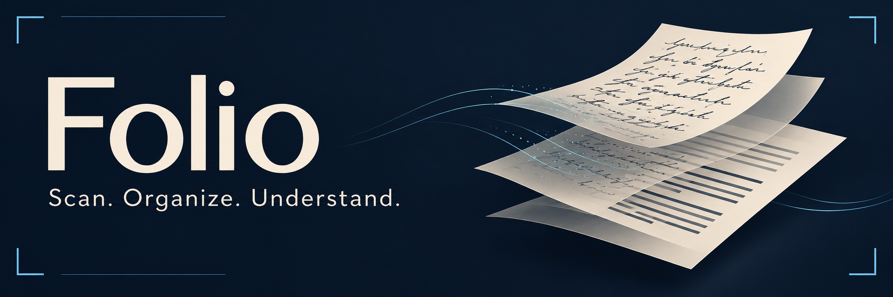
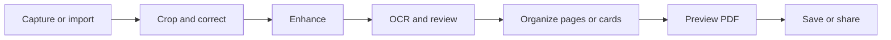
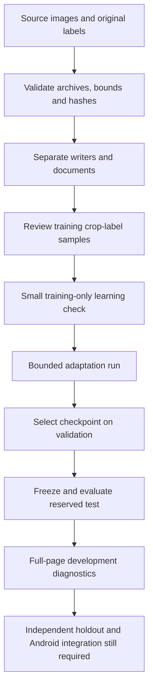

<p align="center">
  
</p>

# Folio

A native Android document scanner built with **Kotlin and Jetpack Compose**, with a separate research pipeline for handwritten English OCR.

Folio brings capture, document correction, text review, card organization and PDF export into one workflow. The app is under active development. Its handwriting experiments are published here as research with measured results; they are not an accepted replacement for the app's current ML Kit engine.

**Status:** working native foundation · experimental handwriting OCR · no Google Play release yet.

## The app

- Fifteen functional screens, animated entry and two onboarding steps.
- CameraX capture, gallery import, retake and retained originals.
- Manual corners, automatic boundary candidates, perspective correction and enhancement with OpenCV.
- On-device Latin OCR, editable text review and WorkManager batch processing.
- Manual ID-card front/back pairing, multiple-card layouts and overflow pagination.
- Searchable scan PDFs and regenerated text PDFs, with preview and native save/open/share actions.
- Local Room database, private image storage, document search, rename, reorder and deletion.

Automatic card-type identification, reliable custom handwriting recognition and comprehensive device/recovery acceptance remain unfinished. A regenerated text PDF is not a promise of exact reconstruction of complex source-page layouts.



## Architecture

| Layer | Implementation |
| --- | --- |
| Interface | Jetpack Compose, ViewModel and saved UI state |
| Application workflow | DocumentRepository, coroutines, revision checks and WorkManager |
| Persistence | Room and app-private files |
| Computer vision | OpenCV geometry, perspective correction and enhancement |
| Current app OCR | Bundled ML Kit Latin recognition |
| PDF | Android PdfDocument for visible pages; PDFBox Android for invisible text and validation |
| Experimental mobile OCR | ONNX detector/recognizer components and standalone Android probes |
| Handwriting research | Python, PyTorch, Transformers and TrOCR |

The custom TrOCR model runs in the host research pipeline. It is **not integrated into the installed app**. Android PdfDocument creates PDF pages; OCR comes from the separate recognition engine.

## Handwriting OCR: the work so far

The objective is dependable handwritten English recognition, with a minimum of **75% completely correct lines** and an 80% stretch target. We adapt pretrained models rather than train an OCR foundation from scratch.

The work has included historical-document pilots, reviewed modern handwriting crops, a compact PP-OCR mobile comparison, ONNX conversion/parity checks, and an IAM adaptation experiment. Difficulties include differences between clean line crops and real photographs, punctuation, capitalization, spacing, line detection and limited representative labelled data. Those constraints explain the evaluation approach; they do not excuse failed acceptance gates.



### IAM method

The supplied forms archive and matching IAM ASCII annotations produced **13,353 line crops from 1,539 pages**. The deterministic custom writer split contains:

| Partition | Lines | Writers |
| --- | ---: | ---: |
| Training | 11,444 | 545 |
| Validation | 881 | 53 |
| Reserved test | 1,028 | 59 |

This is a **custom writer partition**, not the official IAM benchmark split. The upstream handwritten TrOCR foundation already used IAM, so these results do not establish unseen-corpus generalization.

The main run used pinned `microsoft/trocr-base-handwritten`, a frozen encoder, AdamW decoder learning rate `2e-6`, gradient accumulation of four, and 2,861 optimizer updates (one pass). Validation ran every 1,000 updates and at completion; update **2,000** was selected by validation character error under the original policy. The local run used Apple MPS with Python 3.12, PyTorch 2.8.0 and Transformers 4.57.1.

An early training diagnostic exposed a double-shift loss-alignment defect. We corrected the objective to shift decoder inputs once and compare aligned token logits with explicit cross-entropy. A regression test covers the alignment. The corrected eight-line training check reached eight exact lines after 40 updates; that demonstrates memorization, **not held-out accuracy**. Earlier affected pilots are not valid evidence of the corrected objective's quality.

### Measured results

**Lower CER/WER is better. Higher exact-line rate is better.** Exact lines preserve case and punctuation; only NFC and collapsed whitespace normalization are applied.

| Evaluation | Model / decoding | Lines | CER | WER | Exact lines |
| --- | --- | ---: | ---: | ---: | ---: |
| Frozen IAM test | Original TrOCR, greedy | 1,028 | 2.11% | 6.44% | 64.98% |
| Frozen IAM test | Adapted checkpoint 2,000, greedy | 1,028 | **2.07%** | **5.95%** | **66.15%** |
| Later validation-only comparison | Original TrOCR, four beams | 881 | 2.58% | 6.63% | **65.49%** |
| Later validation-only comparison | Adapted checkpoint, four beams | 881 | **2.49%** | **6.17%** | 64.70% |

On the frozen test, adaptation removed 21 character errors and 47 word errors and added 12 completely correct lines. Relative CER improvement was approximately 2.07%, below the original 10% improvement gate. Neither model reaches the current 75% exact-line target.

The final test has already been consumed. Later decoding choices use validation only; a new acceptance claim needs a separate locked holdout or explicit disclosure of benchmark reuse. The validation and test rows above have different purposes and must not be ranked as one leaderboard.

The full-page custom pipeline also ran **15 previously reviewed development photos**. It matched **26 of 28 labelled target regions** at IoU 0.5, but recognition had **47.93% targeted CER**, **73.16% WER** and **1/28 exact lines**. Other page text is unlabelled. This is a partial-label development diagnostic, not complete-page accuracy. It shows a substantial gap between clean IAM lines and practical photographed handwriting.

Aggregate counts, model hashes and experiment boundaries are available in [the benchmark summary](ml/results/benchmark-summary.json). Detailed methodology and historical evidence live in [Testing](docs/Testing.md) and [Backend](docs/Backend.md).

### Mobile experiments and remaining work

The compact PP-OCR path is a separate candidate, not an export of the adapted TrOCR model. Its recognizer preserved exact host outputs on 28 reviewed lines in a standalone Pixel Android runtime probe. Detector-map comparisons also passed on 15 photos. These are equivalence checks, not a representative handwriting benchmark or installed-app acceptance.

The TrOCR checkpoint is approximately 1.24 GiB and is not a practical mobile release artifact yet. Remaining work includes representative independent data, stronger full-page recognition, a mobile deployment approach, installed-app integration, recovery/stress testing and physical-phone evaluation.

## Build and test

### Android

Use Android Studio or a compatible installed **JDK 17–23**, Android SDK 36, and the pinned Gradle wrapper. Android minimum API is 28. Configure your SDK path locally; do not commit `local.properties`.

From the repository root:

```bash
python3 tools/verify_android.py
```

This builds the debug APK, runs JVM tests and lint, and compiles instrumentation tests. It does **not** execute device tests. To run the project's visible-device gate against the existing connected tester:

```bash
python3 tools/verify_android_visible.py --serial emulator-5554
```

The device command replaces the installed debug APK and executes instrumentation; use it on a suitable test device. The repository does not include a production signing key.

### ML

Use Python 3.12 in an isolated environment. Run these commands from the repository root:

```bash
python3.12 -m venv .venv
source .venv/bin/activate
python -m pip install -r ml/requirements-fullpage.txt
python -m unittest ml.test_pipeline ml.test_fullpage tools.test_visible_job
```

Paddle comparisons and export tooling have separate pinned requirements in `ml/requirements-mobile.txt` and `ml/requirements-export.txt`; use separate environments for those paths.

Obtain dataset access and matching labels separately under their original terms. To prepare a locally supplied IAM forms archive:

```bash
python -m ml.prepare_iam_forms \
  --archive /path/to/forms.zip \
  --forms /path/to/forms.txt \
  --lines /path/to/lines.txt \
  --output ml/data/iam-local
```

Preparation validates known metadata pins and does not establish visual approval. Review training crop-label samples and complete the bounded learning diagnostic before training. The main adaptation configuration was:

```bash
python -m ml.train_handwriting \
  --manifest ml/data/iam-local/selection-manifest.jsonl \
  --output ml/artifacts/iam-local-adaptation \
  --foundation base --source-license IAM-original-terms \
  --selection-only --steps 2861 --accumulation 4 \
  --eval-every 1000 --learning-rate 2e-6 --max-tokens 128
```

Choose fresh output directories. This command trains on the supplied data; it is not a bundled pretrained service. Full-page inference additionally requires a local compatible checkpoint and the hash-pinned detector; neither is downloaded implicitly by the inference command. Recorded model revisions and artifact hashes support provenance, but hardware/runtime differences can affect reproducibility.

## Verification and delivery boundaries

- Latest recorded Android build gate: **33 JVM tests, lint, debug build and instrumentation compilation passed**.
- Latest installed full-app baseline: **49 device tests**; later source changes still need installed-app revalidation.
- ML engineering gate: **66 tests passed** in the pinned runtime; the three progress-runner tests passed separately.
- Every backend job started for this project must show stages, measured progress and logs in the local HUD or chat. `tools/run_visible_job.py` publishes durable per-stage records; the local reference HUD is not shipped in this repository.
- Pending app gates include worker/editor process recovery, storage/failure stress, high-resolution memory, external export rechecks, optimized runtime and physical-device acceptance.
- Google Play publication is deferred. Source publication does not imply a finished application or accepted OCR model.

## Repository guide

| Path | Purpose |
| --- | --- |
| `android/` | Kotlin app, schemas, tests and Gradle configuration |
| `ml/` | Data preparation, training, metrics, evaluation, export and experiment policies |
| `ml/results/` | Curated aggregate research results without dataset images or predictions |
| `tools/` | Repository, Android and job-progress verification tools |
| `docs/` | The six canonical project documents |

Read [Project](docs/Project.md), [Architecture](docs/Architecture.md), [Frontend](docs/Frontend.md), [Fundamentals](docs/Fundamentals.md), [Backend](docs/Backend.md) and [Testing](docs/Testing.md) for the full design and implementation record. Dated entries preserve the sequence of experiments; later outcomes supersede earlier pending states.

## Data, weights and attribution

This repository publishes implementation, policies and aggregate results. Dataset archives, cropped images, transcriptions, raw predictions, checkpoints and local experimental bundles are excluded. No model weights or production-ready model release are provided in this milestone; redistribution clearance remains unresolved.

The experiments build on [Microsoft TrOCR](https://huggingface.co/microsoft/trocr-base-handwritten), [IAM handwriting data](https://fki.tic.heia-fr.ch/databases/iam-handwriting-database), [PaddleOCR](https://github.com/PaddlePaddle/PaddleOCR), and the Android libraries declared in Gradle. Dataset and upstream model terms remain separate from this project's source. A mirror download does not establish redistribution rights. The banner is generated artwork, not a screenshot of the app or a training sample.
