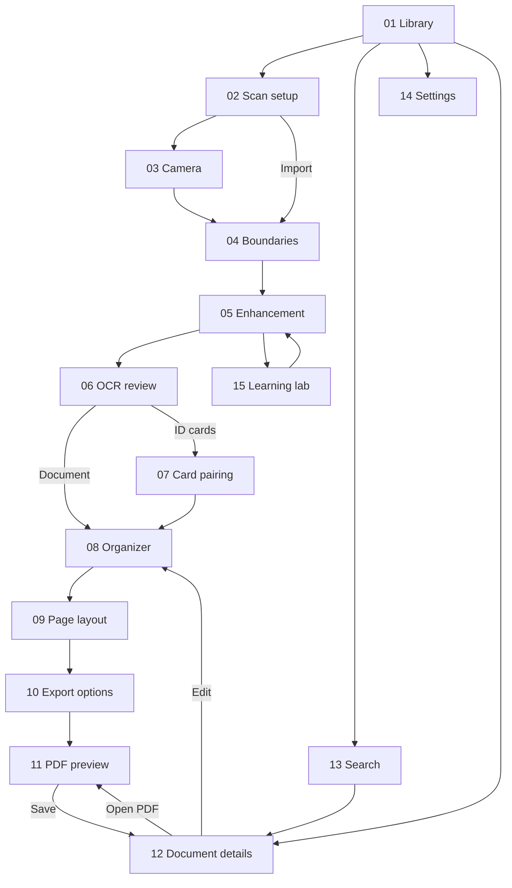
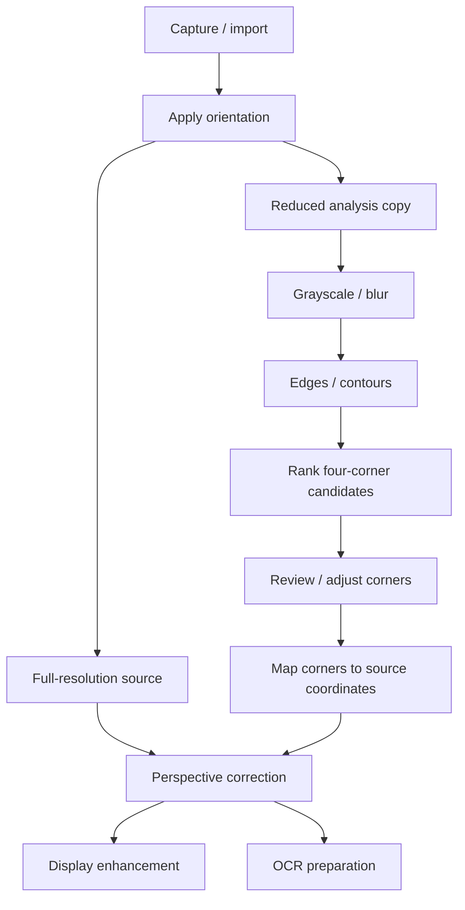
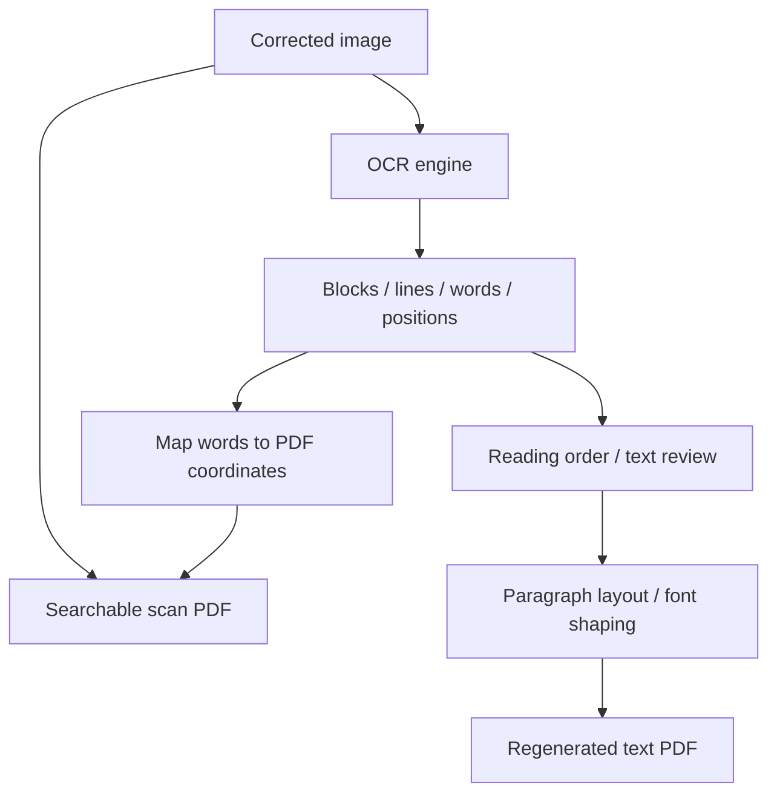
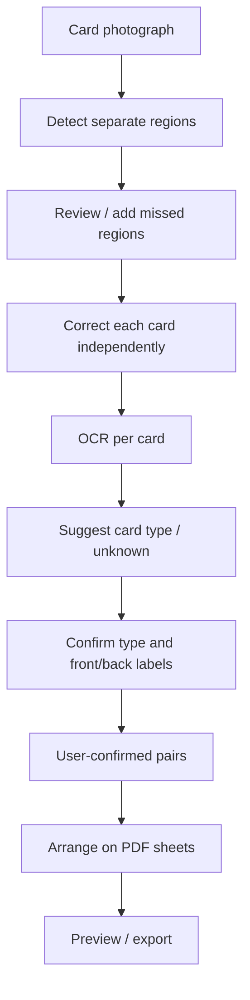
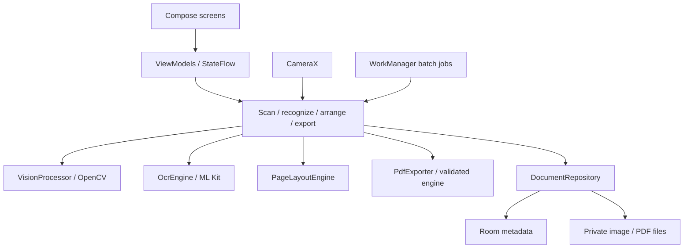
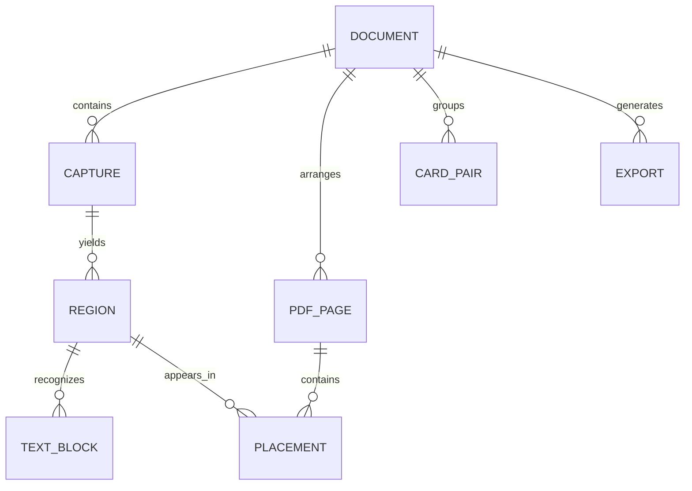

# OCR Scanner - architecture

Status: frontend design baseline v1.0, 14 October 2026. Product architecture is finalized for design. Native foundation implementation has started; technical validation gates remain explicit.

## Product decisions

- Native Android application: Kotlin and Jetpack Compose.
- Custom CameraX + OpenCV scanning pipeline, with inspectable processing stages.
- Bundled ML Kit OCR initially; Latin script first. Additional scripts require selected models, fonts, and representative tests.
- Both searchable scan PDFs and regenerated text PDFs.
- ID mode supports front/back pairing and several cards in one photograph.
- Processing and storage are local; sharing requires a user action.
- Keep original captures and reversible edits while the document exists.
- Initial target: flat documents and fully visible, separated cards.
- Later scope: curved book pages, handwriting, complex table reconstruction, cloud sync, and automatic card pairing.

## User journey and screen connections

15 screens: 14 product screens plus the optional learning lab. Detailed screen purposes, controls, states, and return paths live in [Frontend.md](Frontend.md).

Permissions, image picker, share sheet, keyboard, loading, text-edit sheets, rename, delete, and discard are shared states, not additional routes.

## Vision pipeline

Use low-resolution preview frames for guidance and full-resolution captures for final processing. Keep OCR out of the live preview loop. Display enhancement and OCR preparation are separate: aggressive thresholding can erase characters. Manual corners and recapture are core recovery paths.

See [Fundamentals.md](Fundamentals.md) for concepts and exercises.

## OCR and PDF architecture

| Output | Appearance | Text behavior |
| --- | --- | --- |
| Image PDF | Original scan | Pixels only; not a substitute for a searchable export |
| Searchable scan | Image plus aligned invisible text | Search/copy recognized text |
| Regenerated PDF | Newly typeset paragraphs | Selectable text reviewed before export |

OCR does not automatically reconstruct tables, fonts, columns, logos, or signatures. Initial regenerated output uses simple single-column paragraphs. Original scans remain available.

Use shared transforms for visible images and searchable text: orientation, crop, correction, page scaling, margins, and PDF coordinate conventions. Short word edits retain geometry where possible; large rewrites require alignment review. Never label an export searchable without a usable text layer.

Android PdfDocument can create pages with a Canvas. Searchable export requires a compatibility prototype for invisible text, Unicode mapping, embedded fonts, shaping, extraction order, Android compatibility, licensing, and file size. Test in two independent readers before selecting the PDF engine; transparent painting alone is not proof of searchable text.

## ID-card architecture

Detection locates cards; classification suggests document type; OCR reads printed text; pairing links sides; layout places regions. These are separate responsibilities. No identity or authenticity verification is included.

Begin with geometry, user-selected ID mode, and manual labels. Add type suggestions using OCR keywords and layout only after representative examples exist; allow unknown. Train a detector/classifier only if measured failures justify it. Automatic pairing comes later.

Templates: stacked front/back, side-by-side front/back, and multiple-card grid. Preserve aspect ratio, avoid overlap, respect margins, and create another page for overflow. Physical size is used only when known or entered. Different card families can have different dimensions. Heavy glare and overlapping cards require recapture or manual correction.

Card-image layouts are scan workflows. Regenerated card text uses a separate paragraph layout rather than preserving card imagery.

## Kotlin components

One app module initially, with package boundaries. Use coroutines for interactive work off the UI thread and WorkManager for durable batches. OpenCV includes native processing callable through Android APIs; app code remains Kotlin. Integrating a pretrained OCR model comes first; training our own model is a separate learning extension.

Google's SDK-provided scanner can be a later comparison baseline. The custom pipeline is the primary learning path.

## Data and revision contract

Room stores metadata, OCR geometry, edit recipes, pairs, and placements; large images stay in files. Several card regions can reference one original capture.

Each result belongs to its source revision. Crop/rotation changes invalidate OCR and exports; layout changes invalidate exports while retaining OCR. Old jobs cannot overwrite newer edits. Keep the last valid draft and export when processing fails.

Coordinate chain: oriented source pixels -> corrected region pixels -> OCR geometry -> PDF placement. Store source dimensions and transforms, not screen coordinates. Deleting a document removes its app-owned originals, derivatives, records, and exports; external shared copies remain outside the store.

Field-level records, processing states, build order, and technical gates are maintained in [Backend.md](Backend.md). Acceptance criteria and validation evidence are maintained in [Testing.md](Testing.md).

## Reference artifacts and rules

- [Architecture PDF](../output/pdf/Architecture.pdf): design-baseline snapshot.
- [Project.md](Project.md): the mandatory six-file documentation rule.

## Official references

- [CameraX image analysis](https://developer.android.com/media/camera/camerax/analyze)
- [OpenCV Android](https://opencv.org/android/)
- [OpenCV homography](https://docs.opencv.org/4.x/d9/dab/tutorial_homography.html)
- [ML Kit OCR](https://developers.google.com/ml-kit/vision/text-recognition/v2/android)
- [ML Kit document scanner](https://developers.google.com/ml-kit/vision/doc-scanner/android)
- [Android architecture](https://developer.android.com/topic/architecture/recommendations)
- [Offline-first architecture](https://developer.android.com/topic/architecture/data-layer/offline-first)
- [Android PDF pages](https://developer.android.com/reference/android/graphics/pdf/PdfDocument)

## First-run design extension - 14 October 2026

The user added a logo boot animation and onboarding after the original 15-screen plan. The 15 functional screen IDs are unchanged. Entry flow: boot -> two skippable onboarding states for first-time users -> S01; returning users go directly from boot to S01.

A local browser prototype now represents this navigation and Silk visual language. It simulates processing; the Kotlin component architecture and technical validation gates remain unchanged. Frontend.md owns tokens, assets, and detailed design decisions. The existing PDF remains an earlier baseline snapshot.

## Native implementation boundary

`android/` now contains a minimal Compose integration surface, Room metadata, private image import, bundled Latin ML Kit adapter and revision-checked repository. Full native navigation, correction and PDF/card workflows remain pending. The on-device architecture needs no separate HTTP backend. See [Backend.md](Backend.md) for pinned dependencies and current scope.

## Native processing increment

The Kotlin sources now implement the planned component path using CameraX, OpenCV, bundled ML Kit, Room v2 and WorkManager. PDFBox Android is the provisional PDF engine; Android PdfRenderer provides an independent visual renderer, and text extraction tests check the saved text layer. Edited paragraphs use regenerated output until geometry alignment is explicitly supported. Physical-device and broader reader acceptance are still pending; see Backend.md and Testing.md for exact evidence boundaries.
