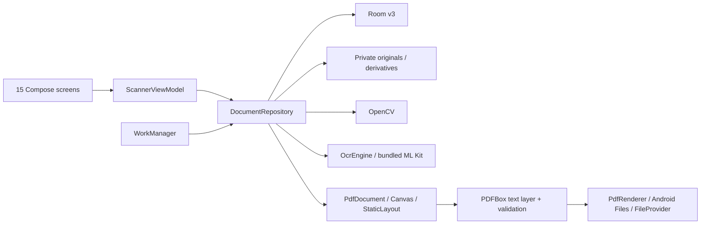
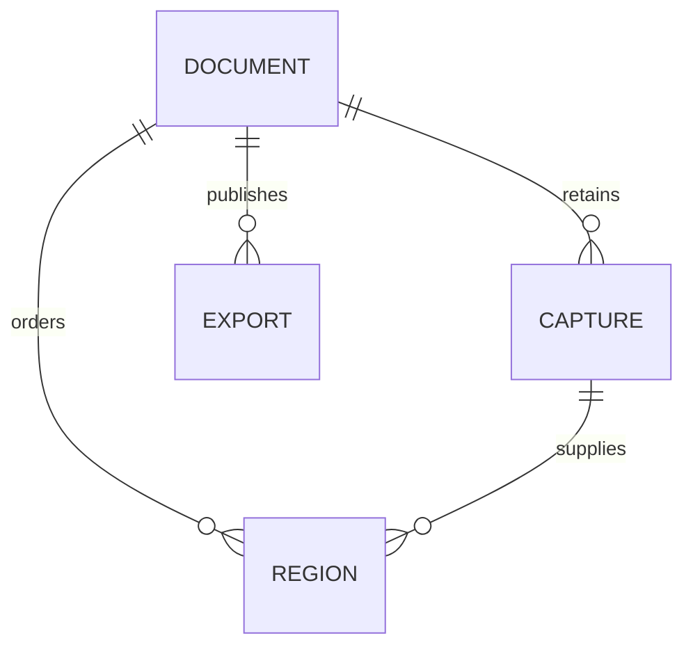
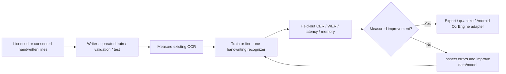
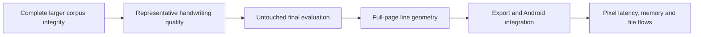

# Backend - Kotlin implementation and acceptance

Current work: develop/evaluate handwritten English OCR while device installation is blocked by emulator storage. The library-backed app and approved native UI remain intact. Backend/device acceptance stays open; source code and recorded execution are authoritative.

## 1. Runtime architecture

The Kotlin backend runs on the device. No web server or cloud upload is required. The browser design website is preserved locally and excluded from GitHub.

## 2. Audit status - 15 October 2026

**Implemented** means the source path exists. **Verified** means an applicable check actually passed. **Open** means required evidence or behavior is missing. A passing older exporter does not validate its replacement.

| Phase | Implementation | Acceptance still open |
| --- | --- | --- |
| P0 Environment and samples | Kotlin toolchain, approved UI, licensed historical lines and reviewed modern validation samples available | Representative physical captures and independent modern held-out evaluation |
| P1 Native interface | All 15 screens, boot and two onboarding steps; screen/navigation/large-text checks passed | Landscape; authored accessible crop actions await device execution |
| P2 Capture and correction | CameraX, import, original retention, retake, manual corners, OpenCV candidates/warp/enhancement | Real-camera quality and large-image memory checks |
| P3 OCR and review | Bundled Latin ML Kit; words/polygons, review, batch worker | Representative accuracy; short corrections with retained searchable geometry |
| P4 PDF output | PdfDocument visible pages, PDFBox invisible text and validation; 48-sheet merge passed in 49-test device gate | External recheck of newest build and high-resolution stress |
| P5 Documents | Room/private files; rename, order, remove, search, defaults, details, native save/open/share | Stress/failure recovery and final external filename check |
| P6 Cards | Manual regions, editable sides/pairs, three templates, overflow pagination | Real-card capture quality; automatic type recognition is later ML scope |
| P7 Reliability and release | Revisions, cancellation checks, atomic import/export, deletion tombstones, 48-region boundaries and setup process-death restoration verified | Worker/editor recovery, high-resolution/forced-failure stress, optimized runtime, physical phone and signing |
| P8 Handwriting model | 42 source tests; two completed 300-step pilots; independent artifact verification; stronger baseline and reviewed modern train/validation corpus | Acceptable recognition quality, representative final evaluation, full-page geometry, mobile export/integration and device validation |

Latest installed baseline: **49 device tests, 23 JVM tests and lint passed**, including the native PDF writer. The corrected separate setup process-death probe passed. The newer accessible-crop build passes compilation/JVM/lint; its 51-test gate cannot install while the Pixel has insufficient storage. The user asked to continue model work meanwhile.

The corrected automated setup recovery probe passed after observing STOPPED/mHaveState=true and verifying a distinct process. Radio choices use Android's checked state; tabs use selected. This evidence covers setup route/mode/workflow restoration. It does not prove WorkManager resumption or every editor's process-death state.

## 3. Actual source ownership

| Source | Owns |
| --- | --- |
| `MainActivity.kt` | Collect state, typed actions, Android picker, native save/open/share and capture exit |
| `feature/ui/FolioScreens.kt`, `Silk.kt`, `CaptureUi.kt` | Approved UI and screen-local pending values |
| `feature/ScannerViewModel.kt` | Navigation, active document/region, orchestration, worker state and errors |
| `feature/capture/CameraCapture.kt` | Permission recovery, CameraX binding and temporary capture files |
| `feature/editor/ImageViews.kt` | Preview, source-coordinate crop gestures and Android PDF rendering |
| `data/DocumentRepository.kt` | Revision-checked edits, private-file ownership, publication and deletion |
| `data/ScannerDatabase.kt`, `PrivateImageStore.kt`, `ScannerPreferences.kt` | Room schema, originals/working images and defaults |
| `data/MlKitOcrEngine.kt`, `OcrBatchWorker.kt` | Recognition adapter and durable unread-region batches |
| `core/Geometry.kt`, `Models.kt`, `vision/OpenCvProcessor.kt` | Geometry, card packing, page placement and image processing |
| `core/pdf/AndroidPdfPageWriter.kt`, `ScannerPdfExporter.kt` | Native visible pages, searchable overlay, validation and atomic export |

One app module is intentional. Earlier proposed feature subdirectories are not separate implemented modules.

## 4. Requirement-to-implementation audit

| ID | Required behavior | Implementation and evidence | Status / boundary |
| --- | --- | --- | --- |
| B01 | Native screens and caller navigation | FolioScreens + ViewModel; NativeUiParityTest and NativeNonMlWorkflowTest | Installed 49-test baseline passed; newer crop increment awaits installation/testing |
| B02 | Capture, denied permission and app-settings recovery | CameraCapture; NativeCameraTest covers actual CameraX capture | Capture passed; exhaustive denial/permanent-denial interactions remain |
| B03 | Import immutable originals and upright bounded copies | PrivateImageStore; ImagePipelineTest covers orientation, limits and corrupt cleanup | Core checks passed |
| B04 | Atomic multi-photo import and retake | Repository importImages/retake; RepositoryPipelineTest | Core checks passed; cancellation immediately after publication needs end-to-end retry proof |
| B05 | Manual/detected document and card boundaries | Quad.validate, CropEditor, candidates, splitCapture, addRegion | Geometry/contour tests passed; accessible corner actions compile but device checks are pending |
| B06 | Reversible correction and enhancement | correct/recipe/preview; OpenCvProcessor works from upright original | Core correction passed; current native preview needs final acceptance |
| B07 | Real OCR with source geometry | OcrEngine -> MlKitOcrEngine -> repository.recognize | Synthetic Latin OCR passed; this is not a handwriting benchmark |
| B08 | Editable reviewed text without stale overwrite | saveReview; DocumentRepositoryTest and NativeRecoveryTest | Revision/recreation tests passed; searchable output rejects any changed paragraph |
| B09 | Durable, cancellable, resumable OCR batches | OcrBatchWorker, KEEP unique work, image/text revisions | Implemented; actual worker process-death/resumption still open |
| B10 | Manual side labels and complete pairs | confirmCardLabels validates all proposed edits in one transaction | Atomic/stale/recreation checks passed in prior baseline |
| B11 | Ordered, aspect-preserving, nonoverlapping sheets | CardLayout/PageLayout; page-layout tests, CardWorkflowTest, overflow UI test | Synthetic pair/grid/overflow checks passed; physical-size printing not claimed |
| B12 | Two real PDF outputs with Unicode | PdfDocument visible pages; PDFBox invisible word layer and text extraction | Writer and disk-backed 48-sheet merge passed device gates; external recheck of newest build remains |
| B13 | Safe publication and previous-export retention | Native/final partial files, validation, rename, sourceRevision | Previous revision/export checks passed; low-storage/process interruption remain |
| B14 | Correct library/search status | Room flows + literal title/review search; publish updates document timestamp without revision | Library-refresh regression passed in the 45-test gate |
| B15 | Private storage and retryable deletion | FileProvider grants only selected PDF; tombstone before file cleanup | Core cascade passed; forced deletion failure and recipient consumption beyond reader remain |
| B16 | Restore pending state and defaults | SavedStateHandle + rememberSaveable; native recovery/navigation tests | Recreation and true process-death setup probe passed; worker/editor cases remain open |
| B17 | Functional save/open/share | Android CreateDocument, FileProvider and chooser | Both synthetic PDFs saved/opened externally; searchable lookup found one match; no recipient was selected |
| B18 | Bounded memory and cleanup | 12 imports/48 regions/20 MB/80M pixels; temporary cleanup | 48-region storage and bounded-image export passed; high-resolution memory and repeated-edit profiling remain |
| B19 | Release readiness | R8/resource shrinking, separate benchmark identity, verification tools | Earlier optimized build only; current optimized runtime/signing/physical phone remain |

## 5. Persisted data and revision rules

- Document: title, mode, workflow, paper, template, margins, revision, timestamp and deletion tombstone.
- Capture: private original/upright paths and upright dimensions.
- Region: capture reference, position, crop/rotation/enhancement, derivative, image/text/OCR revisions, recognized/reviewed text, word polygons and card labels.
- Export: output mode, source revision, completed private path, page count and creation time.
- Room v3 adds workflow; automatic migrations cover v1 -> v2 -> v3. Existing drafts default to multiple-card semantics.

Edits must match the expected document revision. Image changes invalidate OCR and future PDF eligibility while retaining completed older PDFs. OCR commits must also match the source image/text revisions. Import stages files before a single database transaction. Failed cleanup checks whether files were already published before removing them.

Publishing a PDF refreshes the library timestamp without incrementing the document revision: the newly generated PDF must remain current. Shared/exported external copies are outside private-store deletion.

Captures and committed edits are persisted. Pending editor values use saved UI state until Apply/Save/Confirm; do not describe this as unconditional disk autosave of every keystroke. Orphan derivative retention and import cancellation around commit need explicit stress/retry validation.

## 6. Screen action contract

| Screens | Actions |
| --- | --- |
| 01 / 13 | Library filters, new scan, title/text search and details |
| 02 / 03 | Mode/workflow, native import/camera, capture batch, save/discard/continue |
| 04 / 05 | Corners, reset, rotation, retake/add/split, enhancement and Apply |
| 06 | Read/retry, per-region image/text review and caller return |
| 07 | Editable front/back/single labels; one atomic Confirm |
| 08 | Name, reorder, remove confirmation, add pages and per-page editors |
| 09 | Paper, margins, template and every overflow sheet |
| 10 / 11 | Output mode/name, missing-text handoff, actual generation, pagination and library handoff |
| 12 | Edit, delete confirmation, preview and native share/save/open |
| 14 / 15 | Supported defaults, onboarding replay and actual processing-stage views |

No decorative action may silently do nothing. Screen buttons call typed UiAction handlers; debug gallery fixtures are visual review only and never substitute for production backend validation.

## 7. PDF library contract

[Android PdfDocument](https://developer.android.com/reference/kotlin/android/graphics/pdf/PdfDocument) creates new PDFs from Canvas content; it does not provide OCR or card detection. Android StaticLayout wraps/paginates the regenerated single-column text. The source scan/card placements keep their aspect ratios.

PDFBox Android appends explicit invisible recognized words to native scan pages, applies metadata and validates extractable text/page counts before publication. Transparent Canvas painting is not treated as proof of searchable text. Changed reviewed paragraphs currently require regenerated output; word-level realignment remains incomplete. Regenerated output does not recreate tables, fonts, columns, logos or signatures.

PdfRenderer previews actual finished files. Files and FileProvider adapters handle external copies and grants. Native/final partial files are cleaned on failure; startup removes interrupted partial files. Representative-photo, Unicode/font, reader and memory checks must apply to the exact current exporter.

## 8. Handwritten English OCR milestone

Target selected by the user: handwritten English. Printed synthetic text does not establish handwriting accuracy. A 300-step custom line-recognizer pilot has completed; its measured error remains unacceptable for integration. See the results below and Testing.md.

Required deliverables:

1. Licensed/consented line images and exact transcriptions; split by writer/document to prevent leakage. Exclude real ID numbers from public data.
2. Versioned dataset manifest and normalization rules; measured baseline on the same held-out test set.
3. Reproducible recognizer training/fine-tuning and checkpoint provenance. A pretrained handwriting recognizer may be the starting point; training from scratch is not required for ownership of the resulting task-specific model.
4. Character error rate, word error rate, per-case failure analysis and device latency/memory. Choose acceptance thresholds after the baseline; never invent an accuracy target/result.
5. On-device model export and an OcrEngine adapter preserving line/word geometry for searchable PDFs. A line recognizer alone does not detect lines or assign document polygons.
6. Integration behind the existing UI, cancellation/revision rules, fallback and quality gate. Retain the working library pipeline until the candidate proves improvement.

Raw datasets, checkpoints, screenshots and generated reports remain ignored/local. Public source may contain training/evaluation code and non-sensitive configuration. A cloud OCR service is not implicitly authorized by this plan.

## 9. Verification and delivery rules

- Use only the existing Pixel_9_Pro, emulator-5554. Do not create another emulator, resize/wipe it or stop it.
- Run `python3 tools/verify_android_visible.py --serial emulator-5554 --launch-app` for build, JVM, lint and native tests. Add `--recovery` only for the revised process-death gate.
- Local reports live under ignored output/android; exact results and limitations are recorded in Testing.md.
- Test authored/compiled is not test passed. Earlier PDF/device results remain historical after relevant source changes.
- Batch related verified changes into substantial commits and push directly to main. No PRs or new branches unless requested.
- The user explicitly authorized rewriting existing commit messages on 15 October 2026. All 13 were normalized, the first to initial commit; file trees/authors/dates/topology and pending changes were preserved. Future history rewriting needs a new explicit request.
- Update these six existing docs only. No additional Markdown files or generated reference artifacts are committed.

## 10. Handwriting implementation checkpoint

- `ml/manifest.py`: image integrity, required splits and document/duplicate-image leakage checks; writer separation enforced when IDs exist.
- `ml/metrics.py`: corpus CER/WER with reference denominators, NFC/whitespace normalization and preserved case/punctuation. Missing predictions are rejected; insertion errors are not clamped.
- `ml/http_range.py`: bounded, cached, exact HTTP ranges and stored nested-ZIP access. Whole-archive responses and excessive reads are rejected.
- `ml/bootstrap.py`: source-license/provenance inspection and isolated Python environment outside the repository.
- `ml/prepare_subset.py`: exact published line-ID/transcription matching, bounded image extraction and deterministic document-separated pilot splits. Ambiguous editorial annotations are excluded and counted; writer IDs are never inferred.
- `ml/run_experiment.py`: prepares the bounded subset and runs the training/evaluation entry point using the isolated environment. Authored execution code does not establish a completed training run.
- `ml/train_handwriting.py`: pinned TrOCR-small/base, optional encoder adaptation, deterministic seed and validation-only checkpoint selection. Full protocol measures its declared test after selection; selection-only protocol explicitly defers testing. The pretrained baseline is retained unless validation CER improves.
- After checkpoint selection, both selected and pretrained recognizers are evaluated on the same held-out lines. Separate predictions and per-line errors support inspection; test scores do not select checkpoints.
- `ml/requirements.txt`: pinned runtime requirements. The selected model revision is recorded in source and reports.

The English Bentham manuscript source is published at https://zenodo.org/records/248733; its API metadata declares CC-BY-4.0. Metadata and read-entry CRCs are retained. Selective byte-range access was verified, including stored nested ZIPs; the full archive is 6.8 GB and is not downloaded. This source contains historical handwriting. Modern handwriting, writer-generalization and app-device performance remain separate gates. Writer identity is not fabricated from a page ID.

Microsoft TrOCR-small is the existing pretrained starting point. Folio's first decoder fine-tune has now run; its local checkpoint is experimental. The source project uses MIT; model-card and downstream distribution rights must be recorded separately. No checkpoint has been promoted to Android.

Raw data/cache/weights/reports remain under ignored ml/data or ml/artifacts, with force-add checks. Training code is source; no extra Markdown files are created.

The first bounded experiment uses an internal document-separated partition of the published 12-page line corpus. It is not the official competition train/test protocol, a writer-separated benchmark, or modern handwriting validation. Broader training and representative held-out evaluation remain necessary before model promotion.

### Current backend gate

The latest completed gate passed 49 Pixel device tests, 23 JVM tests and lint, including singleTop launcher re-entry. The corrected separate process-death probe also passed: setup route, CARDS mode and multiple-card workflow returned in a distinct process. Its earlier false rejection came from reading selected instead of Android's checked state for radio choices. WorkManager resumption and other editor process-death states remain separate gates.

Native scan authoring now closes each sheet before disk-backed PDF merging. Four additional device checks passed: launcher re-entry, the 48-region storage boundary and deletion, failed-write preservation, and 48-page export cleanup. These bounded synthetic checks do not establish peak memory for 48 high-resolution captures.

### Handwriting evidence - current summary

| Experiment | Data scope | Verified result | App acceptance |
| --- | --- | --- | --- |
| Small decoder pilot, 300 steps | Historical internal development test, 40 lines | CER 76.30%, WER 115.42%, zero exact lines; checkpoint/scores verified | Rejected |
| Small encoder + decoder pilot, 300 steps | Same historical development test | CER 71.56%, WER 106.32%, zero exact lines; checkpoint/scores verified | Rejected |
| Pretrained base, no adaptation | Reviewed HierText development validation, 13 lines | Strict CER 69.10%; casefolded diagnostic 9.73%; one exact line | Unaccepted |
| Base decoder adaptation, 100 steps | Same 13 validation lines; 30 separate training lines | Strict CER 56.45%; casefolded diagnostic 23.60%; one exact line | Rejected: word-reading regression |
| Base encoder + decoder comparison, 100 steps | Same train/validation roles; encoder LR 1e-6 | Strict CER 54.74%; casefolded diagnostic 26.28%; one exact line; artifact verification passed | Rejected: word-reading regression |

The base decoder result selected step 100 by strict validation CER: 232/411 character errors versus pretrained 284/411; WER 72/85 versus 77/85. Capitalization gains mask worse case-insensitive reading. Strict metrics remain primary; the diagnostic does not replace them. Validation selection is not final-test accuracy. Both pretrained and selected checkpoints were independently reloaded: all 13 new predictions exactly match their saved predictions. Immutable model SHA, captured sources, selected/baseline scores and complete steps also verify.

### Corpus and training boundaries

- **Historical:** 2,336 complete line images/transcripts: 1,966 train, 183 validation and 187 test, selected from published document-separated partitions. Extraction and independent image-hash/partition validation passed. This corpus is CC BY 4.0, historical handwriting, with unknown writer identity. Earlier 12-page pilot tests are development evidence after repeated inspection, not an untouched final benchmark.
- **HierText:** official training labels inspected at pinned revision `70b6620b2b112597d8219e11eee9773a1403827c`. Thirty-two sampled photographs yielded 114 crop candidates from 31 boards; all boards were inspected. Thirty unchanged English references were admitted and 84 excluded for transcription mismatch, blur, clipping or inverted geometry. Thirteen independently reviewed validation lines remain separate. A scene-source corpus can include photographs of historical documents; this does not prove contemporary handwriting coverage.
- **Admission:** manifest, crop, original-photo and rendered-review hashes verify. IDs, documents and exact photographs cannot cross roles. Prepared/reviewed datasets refuse replacement. Source labels stay unchanged; review identifies the assistant and does not imply human approval. Sampling is curated, small and not writer-separated.
- **Licenses:** HierText CC BY-SA 4.0 remains separate from Bentham CC BY 4.0. IMGUR5K CC BY-NC 4.0 remains excluded. Model-weight distribution and mobile packaging require their own review.

The trainer supports pinned small/base foundations, immutable checkpoints, captured source hashes, saved validation predictions and explicit train/validation-only selection. Final testing is deferred in that mode, and baseline retention is required unless strict validation CER improves. The current controlled comparison keeps 100 steps, accumulation four, decoder LR 5e-6, validation every 25 steps and the same seed/split; it additionally adapts the encoder at LR 1e-6 from the pinned pretrained foundation.

All **42 lightweight ML pipeline checks pass**. The repository CI workflow now includes them without model/data downloads; hosted execution awaits the next batch push. A completed training run and artifact-integrity pass do not establish recognition quality, full-page geometry, mobile compatibility or device performance.

### Remaining acceptance

Continue the P1-P8 open gates above. Existing Android OCR remains bundled ML Kit. The Pixel's storage block still prevents installation of the 51-test accessible-crop build; no unrelated apps or data are removed. No custom checkpoint is promoted.

The encoder experiment completed at step 100 with 225/411 character errors and 69/85 word errors. Its casefolded diagnostic is 108/411 character errors (26.28%); this confirms that these tiny adaptations do not solve faithful transcription. Larger historical corpus extraction remains active.

A separate mobile-focused comparison is prepared using the official [English PP-OCRv5 mobile recognizer](https://huggingface.co/PaddlePaddle/en_PP-OCRv5_mobile_rec), Apache 2.0, pinned revision `267c36e24c331595590fe7bd72bde2436fd286f2`. Official [recognition documentation](https://www.paddleocr.ai/main/en/version3.x/module_usage/text_recognition.html) describes improved handwritten-English handling. This is a candidate capability claim, not measured Folio performance. Its 7,772,315-byte weight file and three configuration/graph files have pinned upstream SHA-256/Git-blob checks. A separate Python environment protects the TrOCR runtime. The bounded evaluator uses exactly the same 13 admitted validation lines, CPU inference, strict/casefolded metrics and local provenance; no training or Android promotion is implied. Actual installation/inference remains pending.

Host baseline reproduction uses `ml/requirements-mobile.txt` in its own virtual environment, then `python -m ml.evaluate_mobile_baseline` from the repository root. Keep that environment separate from `ml/requirements.txt` and use a fresh output directory for every comparison. No generated files or dependency environments are admitted to Git.

The mobile baseline completed on the same reviewed 13-line development subset: strict CER **17/411 = 4.14%**, WER **19/85 = 22.35%**, three exact lines; casefolded diagnostic CER **14/411 = 3.41%**. Independent rescoring and manifest/review integrity passed. All 13 predictions were inspected. Remaining errors include missing spaces/commas, glyph substitutions and a spurious letter; no automatic transcription repair is applied. Host CPU time was about 0.23 seconds/line, not Android performance. Its executed evaluator source hash verifies and the isolated runtime dependency snapshot is retained locally; `pip check` passed. No model was trained or integrated by this baseline.

A broader development review is prepared next: 24 additional official validation photographs, excluding all eight previously sampled photographs before sampling. Reuse the verified archive cache in a fresh versioned output directory; preserve all existing manifests/reviews. Source selection remains independent of model predictions. Actual preparation, English admission, evaluation, full-page geometry and Android runtime gates are still open. Future baseline evaluations capture source and runtime package snapshots before inference.

The source guard and ignore rules now reject ML weights, dataset archives and raw images even outside the usual generated-data directories. Required Android runtime resources remain allowed.

Expanded development preparation completed: 24 additional photographs yielded 50 crops from 22 rendered boards; 12 other lines failed geometry guards. All boards were inspected before inference. Fifteen unchanged English references from nine photographs were admitted; 35 excluded for reference mismatch, unreadable text or unsuitable crops. All eight earlier photographs were excluded before sampling. Original-photo hashes also verify no overlap with the earlier subset; admitted IDs, document IDs, crop hashes and photo hashes remain separated from training. The expanded mobile comparison is next; its result is pending.

The expanded mobile baseline completed and independently verifies: **29/509 character errors = 5.70% CER**, **23/105 word errors = 21.90% WER**, three exact lines out of 15. Captured source and runtime snapshots verify. Errors include omitted letters/words, spacing, abbreviations and mixed case. These additional curated examples support continued portability work but do not prove representative final accuracy.

The next export uses official Paddle2ONNX 2.1.0 with the pinned model, opset 19 and a separate export environment. Authored checks reject external tensor dependencies, validate ONNX structure and require finite output on a host CPU smoke input. Real-line prediction parity, quantization, Android packaging and device latency/memory remain separate gates; a converted file alone does not satisfy them.

Larger historical corpus preparation and cache prefetch both completed. Independent manifest revalidation confirms all 2,336 image hashes and document/exact-image separation across roles. It remains a subset of published partitions, not writer-separated or the complete benchmark. No recognition result on its 187 test lines has been measured. The complete outer archive checksum remains unverified because selective ranges were used.

ONNX conversion completed and independently verified: self-contained **7,865,035-byte** model, opset 19, dynamic batch/width, 3 BGR channels at height 48 and 438 output classes. Structural/full checks and finite host-CPU output passed. Model SHA: `a27234082983fb2e22a905c400e321a800bff75ee76d85a10219327e242c1c75`. Source/runtime snapshots verify. A fresh conversion does not establish recognition preservation.

Portable BGR resize/normalization and blank-aware CTC decoding are now authored. The next two-runtime gate compares preprocessing arrays exactly against installed PaddleX, then ONNX decoded text against all 28 saved reviewed-line predictions. It requires every prediction to match; failures are retained rather than silently accepted. Android inference, full-page detection/geometry and quality gates remain open.

The real-line export gate passed: portable BGR preprocessing arrays exactly match PaddleX, and ONNX decoded predictions exactly match Paddle on all **28 admitted lines**. Independent input hashes and prediction-dictionary verification passed. This is host prediction parity, not numerical-logit equivalence, Android compatibility or final quality acceptance.

The larger custom experiment is configured from the pinned TrOCR-base foundation: 1,966 historical training lines, 183 validation lines and 187 test lines; 500 steps, accumulation four, decoder LR 1e-5, encoder LR 1e-6, validation every 100 steps. The test is evaluated only after validation fixes the checkpoint and compared with the same pretrained foundation. All 2,336 labels fit the generation bound (maximum 31 tokens; limit 128). The trainer now releases parameter-group references before checkpoint reload to avoid retaining the original model weights. This source change needs the real full-protocol run. No resulting historical score will establish contemporary handwriting or Android quality.

Kotlin portability source is now authored: `core/ocr/LineCodec.kt` implements bounded tensor dimensions, BGR/NCHW normalization and CTC decoding; `OnnxLineRecognizer.kt` verifies the pinned model/config hashes, checks session shapes, serializes line inference and closes native resources. It accepts an actual cropped line and returns text/confidence, without inventing page/word geometry. ONNX Runtime Android 1.31.0 is pinned. Six JVM tests cover aspect/width bounds, channels/padding, repeated letters/spaces, bad inputs and nonfinite output. Compilation, 29 JVM checks and lint are the next gate. Existing device evidence remains the earlier 49-test baseline; this new code has not run on Pixel. No model assets are bundled and the default OcrEngine remains ML Kit.

The Kotlin component passed debug build, all **29 JVM tests**, lint and device-test compilation. APK SHA for that gate: `1fd923998b34c76246c5771e59b909704730a095e7aa0b8f523609e04736ac54`. Device instrumentation did not execute. A debug-only standalone ART probe is now authored for the existing Pixel, with no APK installation or app-private-data access. It stages only DEX/native/model/public sample files in a unique owned temporary directory, retains at least 256 MiB free-space reserve and removes only that directory. It requires 28 exact host prediction matches and records sampled process PSS/timing. A new build and actual probe execution remain pending; this does not replace installed UI/Room/worker acceptance.

The standalone Pixel ART gate passed all **28 exact prediction comparisons** using the Kotlin codec/recognizer and Android native libraries. Independent comparison of actual device strings against the host dictionary passed. Median line-call time was **44.35 ms**, range **21.09-336.18 ms**; this includes preprocessing/bitmap cleanup, excludes model loading and file decoding, and is an emulator diagnostic. Maximum observed process PSS was **182.60 MiB**, not a measured peak. Its own temporary files were removed and absence verified. APK used: `55d6818bc49e4ed56180ccc6633b60319264a90f273d2933a2874622b522a260`. No app update or UI/Room/worker test occurred.

The next host experiment runs the original full photographs through a pinned [PP-OCRv5 mobile detector](https://huggingface.co/PaddlePaddle/PP-OCRv5_mobile_det) plus the verified recognizer. Detector revision `0d63e78e2b680928f6b1747d76a08db6e645efb7`, Apache 2.0; weight file 4,692,937 bytes with upstream SHA verification. Recognition matching uses geometry only, one detection per target and fixed overlap thresholds. Missed targets become empty predictions. Other page text lacks complete labels, so results cannot claim full-page precision or complete-page accuracy. Actual full-page evaluation is pending. All 41 lightweight source tests pass.

The full-photo run completed and independently verifies: **21/28 target lines at IoU 0.5**, 23/28 at the predeclared diagnostic IoU 0.3. Targeted CER is **244/920 = 26.52%**, WER **76/190 = 40.00%**; missing targets count as empty predictions. Host time was about 6.20 seconds/page. These incomplete page labels cannot establish precision or full-page transcription accuracy.

Five failed-case geometry boards were rendered and inspected. Two unmatched lines were read correctly but had expanded boxes below IoU 0.5; other failures include faint cursive, split fabric text and a small green handwritten line. No matching threshold or score was changed. Cropped-line recognition success therefore does not establish reliable full-page OCR. The detector is being exported next for output-map parity and Kotlin implementation; app promotion remains open. The export entry point now supports explicit `--kind detector` in a fresh directory while preserving the verified recognizer artifact.

Detector ONNX export completed: **4,819,576 bytes**, opset 19, dynamic BGR NCHW input and one full-resolution probability map. Structural/finite host checks and independent model/source/runtime hashes passed. Model SHA `cfcb87395c173a9f48d98d1d247b1006b7ed8224db0286709ce2b96fd38bee96`. The next two-runtime gate checks exact preprocessing arrays and probability-map agreement on the 15 full photographs using predeclared absolute/relative tolerances of 0.0005. Threshold-mask differences are recorded separately; map equivalence does not establish box or page-quality equivalence.

Detector resizing uses stride 32 and ties-to-even rounding; the portable codec explicitly tests half-stride boundaries. BGR normalization preserves the pinned publisher's channel order and arithmetic. All 42 lightweight tests pass. A training-only 12-sample spot check found broad source/label correspondence plus faint text, strikeouts, fragments, punctuation-spacing conventions and punctuation-only samples. Neither the live training dataset nor its test split was changed. This does not establish the cause of training regression.

Detector host parity passed on all **15 full photographs**. Portable preprocessing arrays exactly match PaddleX; every ONNX probability map meets the fixed 0.0005 absolute/relative tolerance. Maximum reported absolute error is 0.0001144, with **zero threshold-mask differences** at 0.3. Captured source/runtime and every saved tensor hash independently verify; a second independent inference rerun is not claimed.

Kotlin `DetectorCodec` and `OnnxTextDetector` are now authored: stride-32 ties-to-even sizing, pinned BGR normalization, model-hash/session-contract verification, bounded 9 MP software inputs, owned flat output maps and synchronized native cleanup. Four additional JVM tests cover rounding, unsigned BGR planes and invalid inputs. The new build gate requires **33 JVM tests**. Compilation/lint/new JVM execution and Pixel detector maps remain pending. Probability maps alone do not produce text regions, reading order or an OcrEngine result.

The Kotlin detector component passed debug build, all **33 JVM tests**, lint and device-test compilation. APK SHA `59d2a38651d948972e587081f34161995338fb0989e6d2af7f7480506c84108d`. Pixel detector-map execution remains pending. A debug-only standalone probe is now authored to compare all 15 maps at the same fixed tolerances, using lossless canonical page pixels and verified raw reference maps. It stages only owned temporary files, retains a 256 MiB reserve and verifies cleanup. No app installation or private data access is involved.

The larger 500-step custom experiment completed and independently passed artifact/score verification. Every adapted checkpoint had worse validation CER than the pretrained baseline (17.15%), so the baseline was retained. Its published-partition test result is **1,387/8,683 character errors = 15.97% CER**, **527/1,727 word errors = 30.52% WER**, 16 exact lines out of 187. Training did not improve recognition and no trained candidate from this experiment is admitted. This is historical-handwriting evidence; it does not replace modern or Android quality checks.

### IAM adaptation status - 15 October 2026

IAM import and fixed line-quality promotion checks are implemented in `ml/iam_protocol.py`. Training is blocked on registered `lines.tgz` and `xml.tgz` access; no IAM fine-tuning has run. The existing app still uses ML Kit. See Testing.md's IAM protocol for the fixed metrics, source-access evidence, prior-exposure caveat and separate full-page/device acceptance requirements.

### IAM archive preparation update - 15 October 2026

The metadata-access blocker is resolved for the supplied `/Users/rohanc/Downloads/archive.zip`: downloaded `forms.txt` and `lines.txt` from the Kaggle `maxicode/iam-handwriting` listing match all 1,539 source page IDs and provide 13,353 annotated lines. Original metadata hashes are pinned in `ml/prepare_iam_forms.py`; original terms remain distinct from mirror license labels. XML is no longer required for this ASCII-based import.

The new bounded ZIP-to-line adapter checks writer folders, page dimensions, crop bounds, archive CRCs, image hashes and cross-split leakage. It publishes atomically, preserves source labels (converting IAM `|` separators to spaces), and generates training-only review boards. Fifty pipeline tests pass in the pinned ML environment, including synthetic end-to-end archive import and failed-publication cleanup. Actual corpus preparation and visual review are pending; no IAM training or model-readiness result is claimed yet. The next required gate is visual crop/label review, followed by a small training-only learning diagnostic before longer fine-tuning.

### IAM single-pass training result - 15 October 2026

The run completed all 2,861 updates on 11,444 training lines. Validation selected update 2,000, not the final update. Saved prediction rescoring, selected checkpoint SHA256 and captured source integrity passed independently. Training execution success does not mean quality promotion.

On the identical 881 validation lines (39,760 characters): pretrained CER 2.6685% (1,061 errors), selected CER 2.6610% (1,058 errors); WER 6.8119% to 6.5080%; exact-line rate 64.8127% to 64.0182%. Thus only three fewer character errors, a 0.2828% relative CER reduction, versus the fixed 10% relative-improvement target. Absolute CER/WER/exact-line thresholds pass, but the combined validation promotion gate fails on improvement. No claim of material model superiority or statistical significance is made.

The 1,028 final-test lines remain unevaluated; this custom writer-separated IAM validation is not an unseen-corpus claim because the foundation already used IAM. The selected checkpoint is retained for evaluation, not promoted to Android; Folio still uses ML Kit. Full-page phone-photo recognition, mobile deployment/resource acceptance and integrated review/storage/PDF tests remain separate requirements. No additional training experiment is automatically scheduled.

Evidence: `ml/artifacts/iam-adaptation-v1/training-report.json`, `artifact-verification.json` and `validation-quality-gate.json` (local ignored artifacts).

### Frozen IAM final-test result - 15 October 2026

The original and frozen update-2,000 checkpoints completed all 2,056 predictions on the same 1,028 reserved test lines in 1,073 seconds, with no weight updates. Independent saved-prediction rescoring, model weight hashes and the full corpus manifest hash verified.

Across 48,078 reference characters and 9,549 words: original CER 2.1091% (1,014 character errors), WER 6.4405% (615 word errors), exact-line rate 64.9805% (668 lines). Fine-tuned CER 2.0654% (993 errors), WER 5.9483% (568 errors), exact-line rate 66.1479% (680 lines). This is 21 fewer character errors, 47 fewer word errors and 12 additional exact lines. Relative CER improvement is 2.071%, below the fixed 10% promotion target. Both absolute quality thresholds pass; combined validation/test promotion remains false and app readiness remains false. Statistical significance has not been established.

Measured host inference was approximately 0.494s/line for the original and 0.534s/line for the fine-tuned model; these are Mac inference measurements, not Android benchmarks. Foundation prior IAM exposure limits claims: this is our reserved custom writer-separated scan-line test, not proof of performance on unseen phone photos or full-page recognition. The frozen candidate is retained; Folio still uses ML Kit. Next evaluation needs full-page camera data and mobile feasibility/resource checks. No additional IAM training or test rerun was launched.

Local evidence: `ml/artifacts/iam-frozen-test-v1/evaluation-report.json`, model prediction files and `artifact-verification.json`. The HUD retains the completed comparison.

### Full-page ML engineering and release tools - 15 October 2026

Implemented `ml/fullpage_geometry.py`: bounded DB probability-map thresholding, polygon scoring/expansion, duplicate suppression, perspective crops, deterministic whitespace-based column/heading reading order. Seven geometry tests pass in the existing OpenCV runtime, including permutations, two columns, spanning headings, same-row order, crop endpoints, threshold rejection and input bounds. This is horizontal-English geometric layout handling, not arbitrary semantic document understanding.

Implemented `ml/fullpage_ocr.py`: hash-pinned ONNX detector, frozen TrOCR recognizer, EXIF orientation handling, bounded source/working pixels, source-coordinate polygons and portable JSON output. `ml/run_fullpage_diagnostics.py` is prepared to run the 15 previously reviewed development photos, reporting matched-label recall/CER, host processing time and peak host RSS. Other page text lacks labels; this cannot establish complete-page precision, new-holdout accuracy or Android acceptance. Runtime execution is pending. CPU is selected to avoid scheduling a second GPU workload alongside the decoding comparison. Dependencies are pinned in `requirements-fullpage.txt`.

Implemented `ml/lock_holdout.py`: a new labelled test set must have at least 500 lines and writer IDs; it rejects prior line/document/writer/image/source-photo overlaps. A genuinely new locked set has not been supplied or created. The old final IAM test remains consumed and is not silently reset.

Implemented `ml/build_ml_bundle.py`: allowlisted weights, detector, tokenizer/configuration, portable inference sources and SHA256/size manifest, CRC-verified atomic ZIP publication. No raw training images, source archive, UI references or prediction samples enter the bundle. Experimental local packages remain explicitly unaccepted. Release mode rejects missing new-holdout evidence, wrong model identity, quality below the 75% target, non-finite metrics and unresolved redistribution requirements. Model weight size is 1,273.87 MiB; detector is 4.60 MiB. Mobile packaging/runtime feasibility is still unverified.

The existing pipeline suite now passes 59 tests; geometry adds seven separately passing tests (66 total across the existing runtimes). A unified-runtime verification, full-page development diagnostics and experimental local bundle are prepared as the next finite job. The 75–80% exact-line target is not achieved; no GitHub publication is claimed or performed.

### Completed full-page diagnostic and experimental bundle - 15 October 2026

The finite runtime/test/diagnostic/package job completed successfully. All 66 ML tests passed. The custom TrOCR pipeline processed 15/15 development photographs and matched 26/28 partial-label targets at IoU 0.5. Targeted CER = 441/920 = 47.93%, WER = 139/190 = 73.16%, exact lines = 1/28 = 3.57%. These results fail practical full-page recognition expectations despite strong target detection; they do not measure complete-page accuracy. Maximum host process RSS was 1,968,111,616 bytes. The local experimental bundle is 1,342,049,381 bytes, SHA256 `f45db2902b1bef50024ea84046e4770ff92fae0194dee0f8db1663d25527597c`; no acceptance or Android promotion is claimed.

Existing Pixel standalone detector evidence also passed all 15 map comparisons with zero mismatched pages. This and the 28-line recognizer parity probe test runtime equivalence, not installed-app integration or custom TrOCR quality. The latest recorded Android build/lint/33-JVM-test gate passed; the installed full-app baseline remains the earlier 49-device-test gate. Public README and aggregate benchmark JSON preserve these boundaries.
