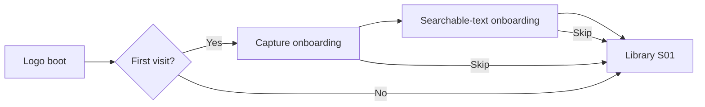

# Frontend - OCR Scanner

Design a complete native Android OCR Scanner app for later implementation in Kotlin and Jetpack Compose. Produce design frames and a clickable prototype first. App implementation, OCR processing, storage, and backend work come later.

## Product

The app captures documents or ID cards, corrects perspective, enhances readability, recognizes text, and creates either a searchable scan PDF or a regenerated text PDF. ID mode supports front/back pairing and several cards photographed together, arranged on the same PDF page. Processing is local. Preserve originals and editable drafts.

## Deliverables

Create exactly 15 named primary screens using IDs S01-S15. Create separate state variants without counting them as new screens. Include a design-token sheet, reusable components, screen annotations, and connected prototype journeys. Use a consistent Android phone frame; test a compact width and large text.

Use a calm, precise document-tool aesthetic. Prioritize the captured page over decorative UI. One accent color, neutral surfaces, consistent spacing, readable typography, restrained elevation, and clear selected states. Provide light designs plus dark-theme token mapping. Use native Android interaction conventions and 48 dp minimum touch targets. Keep implementation terminology out of the product UI.

## Screens

### S01 - Document library
Purpose: Find saved documents and resume drafts.
Show: Thumbnails; title; page count; draft/export status; New scan; Search; Settings.
Entry: App launch; saved-document Back.
Connections: New scan -> 02; item -> 12; Search -> 13; Settings -> 14.
Variants: Empty library; populated library; draft with interrupted work; selection/delete confirmation.

### S02 - Scan setup
Purpose: Choose the scan workflow and input source.
Show: Document or ID cards; ID workflow: front/back or multiple cards; Camera or Import images.
Entry: 01 New scan; 08 Add pages.
Connections: Camera -> 03; system image picker -> 04; Back -> caller.
Variants: Document; front/back cards; multiple cards; import cancelled. Preserve the caller and current draft.

### S03 - Camera capture
Purpose: Capture sharp pages or cards with boundary guidance.
Show: Viewfinder; shutter; flash; capture count; thumbnail tray; Done; optional front/back cue.
Entry: 02 Camera; retake from 04.
Connections: Done -> 04; retake returns to its region; Back -> draft/discard sheet.
Variants: No permission; no boundary; blur/glare suggestion; captured images; missing back. Suggestions must not block manual capture.

### S04 - Boundary editor
Purpose: Confirm the page or each card region before correction.
Show: Four draggable corners; zoom; rotate; add/remove region in multiple-card mode; image switcher; Apply.
Entry: 03 Done; gallery import; 08 Crop.
Connections: Apply -> 05; Retake -> 03; Cancel -> caller.
Variants: Detected corners; no detection/manual corners; multiple cards; invalid/crossed corners. Keep edits per capture.

### S05 - Enhancement editor
Purpose: Choose a readable appearance while preserving the original.
Show: Original/color/grayscale/B&W thumbnails; brightness/contrast; rotate; before/after; Apply; Learning lab.
Entry: 04; 08 Enhance.
Connections: Continue -> OCR processing -> 06; Lab -> 15; Back -> 04 or caller.
Variants: Original; color; B&W; clipped highlights; processing failure. Apply per region; batch apply is explicit.

### S06 - OCR review
Purpose: Review extracted text against the scan.
Show: Image/Text tabs; word highlight; block editor; language; rerun; previous/next region; Continue.
Entry: 05 processing; 08 Text; 12 Review text.
Connections: Document Continue -> 08; ID Continue -> 07; selected word -> edit sheet.
Variants: Recognizing; text found; no text; unsupported script; edits; retry. Do not invent confidence percentages.

### S07 - Card review and pairing
Purpose: Label card regions and confirm front/back relationships.
Show: Card thumbnails; generic/unknown type label; Front/Back/Single; pair/unpair; capture missing side; Continue.
Entry: 06 in ID mode; 08 Pair cards.
Connections: Continue -> 08; capture missing side -> 02 with pending pair; edit text -> 06.
Variants: Unpaired; paired; single-sided; missing back; unknown type. Manual confirmation is authoritative.

### S08 - Document organizer
Purpose: Manage the complete draft before export.
Show: Title; page/card thumbnails; drag reorder; add; crop; enhance; text; duplicate; delete; pair cards in ID mode; Layout.
Entry: 06 document; 07 cards; 12 Edit.
Connections: Editors -> 04/05/06; pairing -> 07; Add -> 02; Layout -> 09.
Variants: One page; multipage; multiple card pairs; empty after deletion; stale OCR after crop change.

### S09 - Page layout
Purpose: Place pages and cards on export sheets.
Show: Page canvas; A4/Letter/Auto; margins; orientation; fit; ID templates: stacked, side-by-side, grid; overflow page count.
Entry: 08 Layout; 10 Adjust layout.
Connections: Continue -> 10; Back -> 08.
Variants: Document fit; card pair; card grid; overflow; unknown physical size. Preserve aspect ratio; use actual size only when known.

### S10 - Export options
Purpose: Choose what the generated PDF contains.
Show: Searchable scan or Regenerated text; filename; output summary; scan compression or text font/size; Generate preview.
Entry: 09; 11 Change output.
Connections: Generate -> progress state -> 11; Adjust layout -> 09; incomplete OCR -> 06.
Variants: Both output modes; pending OCR; failed OCR. Text mode says simple paragraphs; no exact-layout promise.

### S11 - PDF preview
Purpose: Inspect the generated result before saving or sharing.
Show: Page viewer; page counter; search; text selection; output-mode label; Save; change options; edit layout.
Entry: 10 successful generation; 12 Open PDF.
Connections: Save -> 12; Change options -> 10; layout -> 09; Back -> caller.
Variants: Generating overlay; preview ready; no search match; failed export; outdated preview. Shared reader UI for both formats.

### S12 - Saved document details
Purpose: Open, edit, export, or share a saved document.
Show: Title; cover; page count; exports with format/time; Open PDF; Edit; Review text; Share; rename/delete menu.
Entry: 01 item; 13 result; 11 Save.
Connections: Open -> 11 read-only saved mode; Edit -> 08; Text -> 06; Share -> system share sheet; Back -> 01.
Variants: Draft only; current export; older export clearly labeled; export missing; failed share. Regenerate only on request.

### S13 - Search results
Purpose: Find documents using titles and recognized text.
Show: Query field; text matches; highlighted snippets; document/page labels; recent query optional.
Entry: 01 Search.
Connections: Result -> 12 with matched page context; Back -> 01.
Variants: Typing; results; no matches; OCR not run. Searches local metadata and OCR only.

### S14 - Settings
Purpose: Set scanning and export defaults.
Show: Theme; OCR script choice; default paper size; scan quality; learning-lab visibility; local-storage summary.
Entry: 01 Settings.
Connections: Save defaults / Back -> 01.
Variants: Default values; changed defaults; unsupported language. Only expose supported OCR scripts; no model-training UI.

### S15 - CV learning lab
Purpose: Inspect how image processing creates the scan.
Show: Stage selector: original, grayscale, blur, edges, contours, corners, warp, OCR boxes; two-image comparison; short explanation.
Entry: 05 Learning lab when enabled.
Connections: Back -> 05 with edits preserved.
Variants: Stage result; detection failure; no OCR yet; comparison. Experiments never alter the document until explicitly applied.

## Required connected journeys

1. Document -> searchable PDF: S01 -> S02 Document -> S03 -> S04 -> S05 -> S06 -> S08 -> S09 -> S10 Searchable scan -> S11 -> S12. Add another page through S08 -> S02 and return to the same draft.
2. Regenerated PDF: same document flow; correct OCR in S06, choose Regenerated text in S10, then show newly typeset paragraphs in S11. Do not reuse the scan image as the regenerated preview.
3. Paired ID cards: S02 ID / front-back -> capture both sides -> crop and enhance each -> S06 -> S07 confirm pairing -> S08 -> S09 stacked or side-by-side -> S10 Searchable scan -> S11 -> S12.
4. Multiple-card photo: S02 ID / multiple cards -> one photograph -> S04 multiple editable regions -> process each region -> S07 label/pair -> S08 -> S09 grid, including overflow -> S10 -> S11 -> S12.
5. Return visit: S01 -> S13 -> S12 -> S11. Edit goes from S12 to S08; preserve the last saved export until a new export succeeds.
6. Learning: S05 -> S15 -> S05 with the edited draft preserved.

## Shared states and behavior

- Design 15 distinct screens: 14 product screens plus 1 optional learning lab.
- Permissions, image picker, share sheet, keyboard, loading, text edit, rename, delete, and discard are states/sheets, not additional routes.
- Use Android conventions: edge-to-edge layouts, safe insets, system Back, accessible labels, scalable text, 48 dp minimum touch targets, and keyboard-safe editing.
- Keep primary actions near the bottom, previews dominant, and labels short. Use consistent toolbar and editor control placement.
- Choose a restrained neutral palette with one accent; start with light-theme screens and specify dark-theme tokens. Use a single type scale and spacing scale.
- Use fictional paper and card samples with consistent content across the flow. Card-type suggestions can show generic or unknown.
- Preserve drafts, scroll position, selected regions, and return destinations. Do not reset the workflow when opening a sub-editor.
- Front/back is user-confirmed. Missing backs can be captured later or a card can be marked single-sided.
- Keep card aspect ratios. Page overflow creates another sheet; never shrink without a visible preview.
- OCR edits must retain region/word geometry where possible. Whole-block rewrites mark search-layer alignment as needing revalidation; regenerating typed text remains possible.
- If OCR is absent or fails, offer Retry, Review, or Save draft. Never label a PDF searchable without a usable text layer.
- Regenerated output initially supports simple single-column text. Card photos remain a scan-layout workflow; regenerated text uses a separate paragraph layout rather than preserving card imagery.
- PDF preview must reflect the selected output mode. Approximate file size is labeled estimated until generated.
- No sign-in, paywall, cloud dashboard, or backend setup. Two useful, skippable onboarding steps and a logo boot state were added at the user's request on 14 October 2026.

## Prototype details

Connect all primary buttons and editor return paths. Use simulated processing and clearly fictional document data. Include camera permission denial with Settings/retry, no detected corners with manual adjustment, OCR failure with retry, no search matches, missing card back, PDF generation failure, cancellation, and successful saving/sharing. Successful sharing is a prototype state; do not send anything externally.

Autosave draft edits. Back from a sub-editor returns to its caller. Back from capture offers Save draft / Discard / Continue; destructive changes use confirmation. Existing export previews open in saved mode; only reprocess when the user edits or requests a new output.

For OCR review, selecting a word highlights its source region. Short corrections retain positioning; large rewrites indicate that searchable-text alignment needs review. Never show fabricated accuracy scores.

Frame naming: S01 Library / populated, S01 Library / empty, etc. Annotate each connection with trigger, destination, and retained draft state. Mark permission dialogs, system image picker, keyboard, share sheet, and progress overlays as platform/shared states.

## Completion checklist

- All 15 primary screens and required variants are present.
- Both PDF outputs have visually distinct, accurate previews.
- Both ID workflows are complete, including missing back and extra-sheet overflow.
- Empty, loading, error, retry, and cancellation states have clear next actions.
- Navigation, Android Back, editor returns, and draft retention are demonstrated.
- Components and tokens are reusable in Kotlin/Compose later.
- No app/backend code is required in this phase.

## Documentation reference

Maintain this prompt in this existing file. Do not create separate Markdown prompts, screen specifications, or handoff files. Follow the six-file rule in [Project.md](Project.md).

## Silk design baseline - 14 October 2026

The supplied nine Stitch screens are visual references, not layouts to copy verbatim. Reference HTML and screenshots are preserved in `design/reference/`; archive instructions were treated as reference data. The archive's DESIGN.md was not added to the project.

### Design workspace

- Wireframe and prototype (local artifact: `design/index.html`): full flow map, 15 low-fidelity frames, interactive phone preview, and route explorer.
- Phone prototype (local artifact: `design/prototype/index.html`): isolated phone-size design for later Kotlin translation.
- Local preview: run `python3 -m http.server 8770 --bind 127.0.0.1` from the `design` directory, then visit `http://127.0.0.1:8770`.
- Serve over HTTP; the browser prototype uses JavaScript modules. Opening it through a file URL is not the supported preview path.
- 15 functional screens remain. Boot, onboarding capture, and onboarding text are three additional entry states, for 18 distinct views.
- This is browser design code, not a scaffolded Android application. Capture, OCR, CV transformations, and PDF generation are explicitly simulated; local image import, text edits, selection, navigation, pairing, and draft storage respond to real UI actions.

### Visual system

| Role | Specification |
| --- | --- |
| Surface | Cool Silk gray #E8EAF0 |
| Primary text | Ink #2E3040 |
| Secondary text | Slate #5B5E70 |
| Single accent | Muted indigo #6265CE; darker text accent #4F52AD |
| Typography | Locally served Plus Jakarta Sans; 400-700 weights |
| Hierarchy | 18 px app titles, 14-15 px primary control/list text, 12-14 px body, 10-11 px supporting metadata |
| Spacing | 24 px content gutters; 8/12/16/24/32 spacing rhythm |
| Touch controls | 48 px minimum primary targets; corner handles also support arrow keys |
| Shape | 12-20 px soft corners; round shutter only where its function requires it |
| Raised depth | Two soft opposing shadows; mostly the same color as the parent surface |
| Inset depth | Recessed selections, fields, and image workspaces |
| Motion | One brief logo reveal and scan sweep; short sheet transitions; reduced-motion alternative |

Silk informs the atmosphere. Contrast, readable text, and clear selected states take priority over low-contrast ornament. Perpetual attention-seeking animation, extra accent colors, and oversized nested cards were omitted. Web hero rules are not imposed on native editor screens.

### Controls retained and removed

| Retained | Reason |
| --- | --- |
| Capture/import, manual corners, retake | Acquire and correct source images |
| Filters and brightness/contrast | Explore enhancement choices |
| OCR text review and rerun | Review recognized text and recover failures |
| Card side labels and pair names | Explicit manual front/back association |
| Reorder, delete, layout templates | Produce the intended page arrangement |
| Export format, preview, save, share sheet | Complete the document flow |
| Search and supported defaults | Find documents and reduce repeated setup |
| Optional learning lab | Support the project's CV learning goal |

Removed from the reference designs: cloud sync, accounts/profile avatar, fabricated OCR confidence/accuracy scores, redundant search entry points, duplicated camera exit buttons, decorative workflow badges, and unimplemented technical feature toggles.

### Asset generation

Built-in image generation created the transparent logo, two Android onboarding concepts, and two separate onboarding illustrations. All five outputs are saved in the project. The prototype uses real text and interactive controls over standalone artwork; it does not use a generated screen screenshot as UI.

- Logo: `design/prototype/assets/logo.png`
- Standalone artwork: `design/prototype/assets/capture-art.png` and `text-art.png`
- Screen concepts: `design/concepts/onboarding-capture.png` and `onboarding-text.png`
- Prompt set and provenance: asset prompts (local artifact: `design/asset-prompts.json`)

### Stitch connection

The existing Stitch MCP connection was verified by listing the private OCR Scanner project and its nine screens. Project resource: `projects/3229319760474996003`. Endpoint: `https://stitch.googleapis.com/mcp`.

No global MCP settings were changed. The supplied API key was not copied into application code, documentation, images, or project configuration. No additional credentials were necessary for the already connected MCP server.

### Review status

The user-approved browser wireframe and prototype are the visual authority. Native implementation acceptance remains separate. See [Testing.md](Testing.md) for current device evidence and limitations.

### Website retention and launcher

The design website is a permanent project deliverable, retained at the user's explicit request. `Start Scanner Design.command` opens it; `tools/serve_design.py` serves the same source without third-party packages. Keep this website through the later Kotlin build. Existing documentation remains restricted to the six files in `/docs`.

Review screenshots are saved in `output/design/`: `overview.png`, `wireframe.png`, `workspace.png`, and `screens/`. These are reference images; the website remains interactive.

## Native integration increment

`android/` now authors the 15 functional routes, shared error/confirm states, brief logo reveal and two skippable onboarding steps. Native controls are connected to private import, CameraX, correction, OCR, review, pairing, layout and actual PDF adapters. This is an initial native implementation of the permanent browser reference; screen-by-screen visual/device parity has not yet been accepted. Searchable generation explains the restriction on rewritten paragraphs; PDF preview labels previous exports when newer edits exist. The website is retained unchanged by this native increment.

## Native reference alignment - 14 October 2026

Authority: the user-approved `design/prototype/` and existing screen frames. The original native list of full-width Material buttons did not satisfy that design and is being replaced.

| Prototype element | Native owner |
| --- | --- |
| Plus Jakarta Sans, colors, opposing depth, icons, controls | `feature/ui/Silk.kt` |
| S01-S15 plus boot/onboarding composition | `feature/ui/FolioScreens.kt` |
| Camera viewport, shutter, capture count, tray and Done | `feature/ui/CaptureUi.kt` |
| Screen inputs and typed UI actions | `feature/ui/ScannerUi.kt` |
| Existing Kotlin/Android action adapters | `MainActivity.kt` |
| Fictional review fixtures, debug build only | `src/debug/.../UiGalleryActivity.kt` |

Preserve compact two-line toolbars, 24 dp gutters, preview-led editors, thumbnail regions, four filter choices, inset fields/segments and fixed bottom primary actions. Use real Android status/navigation bars and platform picker/share dialogs. Native product copy replaces browser-only simulation notices; no sample documents enter the real library.

The debug review activity renders the same production components with fictional paper/card fixtures. Launch after installing the debug APK: `adb shell am start -n com.rohanc.ocrscanner/.feature.ui.UiGalleryActivity --es screen 01`. IDs 01-15 and intro-1/intro-2 are supported. This is visual review, not proof of an OCR/PDF backend operation. The launcher activity remains the actual app with private user data.

Visual acceptance requires native captures of all 17 screens, comparison against the approved browser screens, primary-action/navigation checks and a large-text pass. Source implementation or successful compilation alone does not prove a match. Record actual outcomes in Testing.md before claiming parity.

Remaining backend connections are reviewed per page after UI acceptance. Existing camera/import/correction/OCR/PDF adapters are retained and regression-tested, rather than being replaced by gallery fixtures.

### Pixel 9 native review - 15 October 2026

All 15 routes and both onboarding steps now use the shared native Silk components. Native screen board (local artifact: `output/android/ui-parity-pixel9/screen-board.png`). Captures cover normal text, 200% text and a 320 dp content width at 200% text on the existing Pixel 9 Pro. These are fictional review fixtures rendered through production UI components. Native UI acceptance remains with the user before further backend work.

Reference paths in this specification refer to the preserved local design workspace. Reference HTML, concept artwork and rendered UI frames are excluded from GitHub; only Android runtime artwork remains in the repository.

## Folio editorial website - 16 October 2026

The editorial is a separate local presentation at `design/editorial/index.html`, served at `http://127.0.0.1:8770/editorial/`. The existing app wireframe and prototype remain at `design/index.html` and `design/prototype/`; their source hashes were checked unchanged. Do not embed a phone, app screenshot, app iframe or wireframe into the editorial. The user rejected that approach. Keep the app test bench as a separate linked destination.

The revised visual direction uses ink black, bone white, vermilion, oversized Anton typography and generated monochrome scan artwork. Main chapters: Keep what matters; From noise to meaning; The work; source colophon. The motion storyboard at `design/editorial/motion.html` is a separate scrubbable editorial wireframe, not the app wireframe.

WebGL uses local Three.js 0.180.0 and custom vertex/fragment shaders for document displacement, alignment, a scan line and subtle pointer perspective. Rendering is requested on input, resize or scroll and stops when idle/hidden. Desktop uses a native-scroll pinned sequence; mobile and reduced motion use direct step controls without pinning. Static artwork remains when WebGL is unavailable. The transformations are illustrative, not browser OCR inference. Research claims retain the actual frozen IAM metric, unmet target and weaker real-photo diagnostic.

Generated v2 concepts, production artwork, design tokens and exact built-in imagegen prompts are retained under the ignored `design/editorial/` directory. This work does not deploy or push the website.

### Separate chapter artwork - 16 October 2026

The accepted black/bone/vermilion direction is retained. The hero keeps `assets/scan-art-v2.png`; the process now uses separately generated `assets/process-art-v3.png`, a front-facing document study with registration marks and extracted text fragments. Independent, section-scoped WebGL scenes prevent the hero from persisting into the process. Mobile, reduced-motion/no-WebGL fallbacks and the motion storyboard use the corresponding chapter artwork. The app wireframe remains separate.

## Reusable frontend style library

Saved 16 October 2026 at the user's request. This is the project reference for reusing visual styles; it is not a global preference for every future project. Match a future project's content and scope before adapting a recipe.

### Style index

| Reference name | Character | Appropriate surface | Status |
| --- | --- | --- | --- |
| **Folio Industrial Editorial** | Ink black, bone white, vermilion, oversized condensed type, monochrome scan imagery, scroll storytelling | Editorial product websites and research case studies | Current preferred website direction |
| **Silk Native** | Soft depth, restrained neutral surfaces, generous preview space, compact functional controls | Folio's native Android app and app prototype | Existing accepted app direction; keep separate from the editorial |
| **Technical HUD** | Navy/black, cyan instrumentation, circular gauges, measured counts and bounded logs | Backend/ML progress monitoring | Existing monitoring direction; not the marketing website |
| **Warm Paper Editorial** | Ivory, burgundy, expressive serif type, softly floating paper | Archived alternative only | Rejected for this editorial; do not restore as its default |

The detailed Silk app specification remains earlier in this file. The local HUD reference is `output/training-monitor/`; its measured progress must never be replaced with decorative percentages. Rail and offlineQr are user-supplied references for editorial ambition, not templates to copy without inspecting the applicable project.

### Folio Industrial Editorial — style identity

**Practical name:** Industrial Editorial / Kinetic Typography.

This is a descriptive combination, not a claim of one formal design movement. Its influences are Swiss editorial grids, restrained neo-brutalist geometry, photographic archive art direction and motion-led typography. The character comes from scale, contrast, composition and pacing rather than interface decoration.

| Ingredient | Reusable rule |
| --- | --- |
| Typography | Condensed uppercase display type at poster scale; small readable supporting sans text; monospaced structural labels |
| Layout | Asymmetric editorial spreads, open negative space, edge-to-edge bands, fine rules and deliberately varied section density |
| Palette | Ink-black foundation, bone-white content and one strong vermilion accent |
| Artwork | Monochrome tactile documents, ink, registration marks and sharp photographic edges |
| Interaction | Native scrolling, purposeful pinned chapters on desktop, direct controls and subtle pointer depth |
| Closing | A strong contrasting colophon with real source/resource links |

### Tokens and typography

| Token | Value / use |
| --- | --- |
| Background | `#101110` |
| Primary text | `#edece6` |
| Accent | `#ff5b35` — selected steps, punctuation, scan marks, primary action and closing band |
| Secondary text | `#93958f` |
| Rules | `#363833` |
| Display font | **Anton**, weight 400; condensed uppercase; approximately `-.025em` to `-.035em` tracking; `.94–1.03` line height |
| Body font | **Plus Jakarta Sans**; approximately 12–16 px desktop body copy, with readable mobile equivalents |
| Structural labels | `SFMono-Regular, Consolas, monospace`; approximately 9–11 px; never use tiny labels for essential instructions |
| Page gutter | `clamp(22px, 4.2vw, 80px)` |
| Motion easing | `cubic-bezier(.22, 1, .36, 1)` |

Current desktop hero scale is `clamp(115px, 15vw, 260px)`; mobile overrides it to `clamp(72px, 21vw, 134px)`. These are Folio implementation values, not universal settings. Recalculate long-word fit, line breaks, contrast and touch-target sizes for each new project.

### Composition recipe

1. **Opening:** a short oversized headline, one clear action and one cinematic image. Keep hero text as real HTML. No decorative eyebrow or invented proof metric.
2. **Transformation:** a distinct composition and artwork for the next chapter. Show meaningful change through scrolling; also provide direct step selection.
3. **Evidence:** reduce visual noise, explain the actual work and label measured results and limitations. Do not animate a score to suggest improving accuracy.
4. **Colophon:** a deliberate contrasting band, large wordmark and a few useful destinations.

Keep navigation short, controls rectangular, arrows consistent and hover feedback restrained. Avoid rounded card grids, decorative dashboards, ornamental pills, unrelated widgets and repeated copies of the hero image.

**Folio-specific boundary:** the app wireframe belongs exclusively in its separate test bench. Do not embed a phone, app screenshot, iframe or device frame in this editorial or its editorial motion storyboard. Preserve the app UI's own Silk design language.

### Artwork and motion recipe

Use separate generated assets for major chapters while keeping the same palette, lighting and texture language:

- **Hero:** `design/editorial/assets/scan-art-v2.png` — diagonal, layered archival documents and scan light.
- **Process:** `design/editorial/assets/process-art-v3.png` — front-facing document, registration corners and extracted text fragments.
- **Concepts:** `design/editorial/concepts/hero-v2.png`, `process-v2.png`, `notes-v2.png`.
- **Exact generation prompts:** `design/editorial/asset-prompts-v2.json` and `process-art-v3-prompt.json`; built-in imagegen was used.

The independent WebGL scenes use local Three.js with vertex/fragment shaders for fragmentation, alignment, scan movement and subtle perspective. They render on demand and stop while idle or hidden. Do not add an endless background render loop just to make a page feel animated.

Use native scrolling. Preserve reduced-motion support, direct controls, static no-WebGL artwork and a natural mobile reading order. Keep each chapter's own image in these alternatives. Motion illustrates the story; it must not be presented as real OCR execution.

### Reusable design brief

> Create an industrial editorial website for [project] using ink black, bone white and a single vermilion accent. Use oversized condensed uppercase typography, asymmetric Swiss-inspired grids, sharp rules, cinematic monochrome imagery and generous negative space. Give each major chapter distinct artwork within one consistent visual language. Use scroll-driven WebGL only where it explains a transformation, with native scrolling, idle/offscreen rendering gates, reduced-motion alternatives and mobile fallbacks. Keep real copy and controls in HTML. Avoid generic card grids, decorative dashboard chrome, fake metrics and unused controls. Keep any product wireframe or test bench separate unless this project's brief explicitly requests an embed. Ground the content and evidence in the actual product.

### Reuse acceptance checks

- Compare headline/nav copy, type hierarchy, palette, section rhythm and image treatment with the chosen references.
- Verify every visible action, step control and source link.
- Check desktop and narrow mobile widths for clipped text, overlap, contrast and horizontal overflow.
- Verify reduced motion, no-WebGL fallbacks and idle/offscreen rendering behavior.
- Keep dataset/model results factual and distinguish illustrative scenes from working product behavior.
- Save new project assets inside that project's workspace; retain prompts and licenses. Do not copy private samples or credentials.

**Live local references:** editorial `http://127.0.0.1:8770/editorial/`; motion storyboard `http://127.0.0.1:8770/editorial/motion.html`; separate app test bench `http://127.0.0.1:8770/`. These URLs require the local preview server.

### Next.js expansion — 16 October 2026

The complete editorial source now lives in ignored `design/folio-web/`, using Next.js App Router, React, TypeScript, local Anton/Jakarta fonts and lazy Three.js. The previous static editorial and original app test bench are preserved. This is the website presentation of the native Kotlin app; browser OCR is not introduced.

| Route | Purpose |
| --- | --- |
| `/` | Long-form editorial: opening, six-stage scroll journey, OCR review, interactive card arrangements, accessible PDF comparison, library, supporting features and measured OCR research |
| `/process` | Detailed capture → correction → review → organization → export → library explanation, output limitations, onboarding/defaults/learning lab, and a text map of all 15 screens |
| `/motion` | Scrubbable six-chapter editorial storyboard with artwork, triggers, movement and quiet alternatives; no embedded app/device frames |

Six new built-in-imagegen production assets explain capture, perspective correction, handwriting review, fictional card pairing, the two PDF outputs and local organization. The approved opening image remains distinct. Five separate generated design studies informed the expanded spreads. Exact prompts and the reusable design specification are saved in `design/folio-web/design/asset-prompts.json` and `design-spec.json`; generated studies are alongside them. No new Markdown file was created.

The industrial style stays ink black, bone white and vermilion, with oversized condensed type, sharp rules, asymmetric spreads and a contrasting bone-white card section. HTML carries all explanatory copy and controls. Native scrolling drives the desktop workflow; mobile/reduced-motion alternatives use direct chapter controls. WebGL loads on visibility, renders on demand, disposes resources, and falls back to the correct static chapter artwork. Card controls change illustrations; PDF tabs explain the actual export distinction. Neither pretends to process an uploaded document.

Content preserves implementation boundaries: ML Kit is the current app recognizer; custom TrOCR remains experimental and unintegrated; cards are manually confirmed; edited paragraphs need regenerated text or a fresh OCR pass for searchable geometry; newer installed-app and recovery acceptance remain open. The measured 66.15% frozen exact-line result and unmet 75–80% target remain explicit.

**Verification state:** artwork/provenance checks passed for seven distinct images; all 17 protected test-bench hashes match; `/docs` still contains exactly six Markdown files. Dependency installation, production build and the new browser matrix must complete before this Next.js version is described as browser verified. Planned preview port: `8771`; existing static preview remains on `8770`.

### Scanner-line removal — 16 October 2026

Removed the animated vermilion scan-line shader from the Next.js editorial; existing edge fades, image disappearance/crossfade and document motion remain. Storyboard wording matches. The preview now runs in development mode on the same port, 8771, so refinements appear immediately. A targeted browser check also found 13px of mobile library-art overflow; clipping that artwork composition fixes it without changing the layout.

### Public website source and deployment — 16 October 2026

`website/` is the publishable Next.js application in the Folio GitHub repository. It contains the three editorial routes, application source, seven production artworks, local fonts/licenses and a pinned npm lockfile. It excludes generated reference studies, local wireframe HTML, browser tooling, datasets, model artifacts, local credentials and development outputs. `design/` remains ignored and its app test bench is preserved.

Vercel must use Root Directory `website`, Next.js, Node 22, `npm ci` and `npm run build`, connected to `InsaneCoder789/Folio` with production branch `main`. Only the website is built and deployed; Android and ML retain their own workflows. The website has no required secret/environment variables or cloud OCR service. Public resource links lead to the GitHub native design guide instead of a visitor's localhost. The local test bench is not published.

This production source is the version to edit for future website releases. `design/folio-web/` preserves the earlier local presentation. Vercel production deployment is READY at https://folio-rochiees-projects.vercel.app (also https://folio-sigma-beige.vercel.app), from commit `c94270f`. Project `folio` in `rochiees-projects` is confirmed linked to `InsaneCoder789/Folio`. Its ignored-build command, `git diff HEAD^ HEAD --quiet -- .`, runs inside `website` so changes outside that folder do not rebuild the website. Standard Vercel protection keeps deployment/preview URLs protected while the production aliases are public.

### Public prototype subpage — 17 October 2026

At the user's explicit request, `/prototype` publishes only the original interactive app prototype as a separate editorial navigation tab. The main editorial and motion storyboard retain their existing compositions. No wireframe inventory, reference gallery, design-bench tabs or ML HUD is published.

The original four JavaScript modules and base stylesheet are copied byte-for-byte to `website/public/prototype/`; `source-integrity.json` records their SHA256 hashes. The same sample library, boot/onboarding, fifteen screens, document/card journeys, corner editing, simulated OCR/PDF review, local saves, search/settings and learning lab remain. `editorial.css` overlays Anton display headings, Jakarta body text, ink/bone/vermilion colours, flat borders and restrained corners. Document specimens stay paper-coloured for contrast. Original onboarding art and logo remain, with CSS monochrome treatment.

A Next route handler serves the player document at `/prototype-player`; no reference HTML file is added to Git and no repository protection is relaxed. The player is isolated in the prototype subpage so its DOM/CSS does not affect the editorial. Its policy blocks network connections and external embedding, and the player route is excluded from indexing. The outer page explicitly identifies camera, OCR and PDF generation as simulated. Files selected inside the prototype stay within its existing browser-only workflow.

The seventeen protected original design-bench files are unchanged. `/docs` still has exactly six Markdown files. Next.js automatic agent-document generation is disabled to preserve that documentation constraint. Local development for the publishable website uses port 8772 with Webpack because the existing local dependency directory is symlinked; production continues using Vercel's independent installation. Verification and deployment status are recorded in Testing.md.

**Published prototype:** https://folio-rochiees-projects.vercel.app/prototype — READY from `e9cbc81`, verified in production on desktop and mobile and opened in the in-app browser. Future changes to the prototype theme belong in `website/public/prototype/editorial.css`; keep the original interaction modules intact unless a behavior change is explicitly requested.
