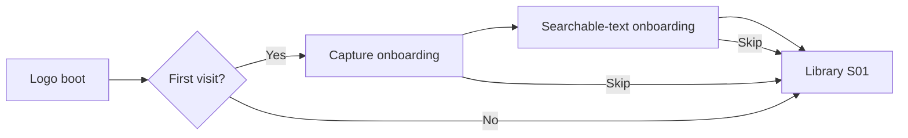

# Frontend - OCR Scanner

Design a complete native Android OCR Scanner app for later implementation in Kotlin and Jetpack Compose. Produce design frames and a clickable prototype first. App implementation, OCR processing, storage, and backend work come later.

## Product

The app captures documents or ID cards, corrects perspective, enhances readability, recognizes text, and creates either a searchable scan PDF or a regenerated text PDF. ID mode supports front/back pairing and several cards photographed together, arranged on the same PDF page. Processing is local. Preserve originals and editable drafts.

## Deliverables

Create exactly 15 named primary screens using IDs S01-S15. Create separate state variants without counting them as new screens. Include a design-token sheet, reusable components, screen annotations, and connected prototype journeys. Use a consistent Android phone frame; test a compact width and large text.

Use a calm, precise document-tool aesthetic. Prioritize the captured page over decorative UI. One accent color, neutral surfaces, consistent spacing, readable typography, restrained elevation, and clear selected states. Provide light designs plus dark-theme token mapping. Use native Android interaction conventions and 48 dp minimum touch targets. Keep implementation terminology out of the product UI.

## Screens

### S01 - Document library
Purpose: Find saved documents and resume drafts.
Show: Thumbnails; title; page count; draft/export status; New scan; Search; Settings.
Entry: App launch; saved-document Back.
Connections: New scan -> 02; item -> 12; Search -> 13; Settings -> 14.
Variants: Empty library; populated library; draft with interrupted work; selection/delete confirmation.

### S02 - Scan setup
Purpose: Choose the scan workflow and input source.
Show: Document or ID cards; ID workflow: front/back or multiple cards; Camera or Import images.
Entry: 01 New scan; 08 Add pages.
Connections: Camera -> 03; system image picker -> 04; Back -> caller.
Variants: Document; front/back cards; multiple cards; import cancelled. Preserve the caller and current draft.

### S03 - Camera capture
Purpose: Capture sharp pages or cards with boundary guidance.
Show: Viewfinder; shutter; flash; capture count; thumbnail tray; Done; optional front/back cue.
Entry: 02 Camera; retake from 04.
Connections: Done -> 04; retake returns to its region; Back -> draft/discard sheet.
Variants: No permission; no boundary; blur/glare suggestion; captured images; missing back. Suggestions must not block manual capture.

### S04 - Boundary editor
Purpose: Confirm the page or each card region before correction.
Show: Four draggable corners; zoom; rotate; add/remove region in multiple-card mode; image switcher; Apply.
Entry: 03 Done; gallery import; 08 Crop.
Connections: Apply -> 05; Retake -> 03; Cancel -> caller.
Variants: Detected corners; no detection/manual corners; multiple cards; invalid/crossed corners. Keep edits per capture.

### S05 - Enhancement editor
Purpose: Choose a readable appearance while preserving the original.
Show: Original/color/grayscale/B&W thumbnails; brightness/contrast; rotate; before/after; Apply; Learning lab.
Entry: 04; 08 Enhance.
Connections: Continue -> OCR processing -> 06; Lab -> 15; Back -> 04 or caller.
Variants: Original; color; B&W; clipped highlights; processing failure. Apply per region; batch apply is explicit.

### S06 - OCR review
Purpose: Review extracted text against the scan.
Show: Image/Text tabs; word highlight; block editor; language; rerun; previous/next region; Continue.
Entry: 05 processing; 08 Text; 12 Review text.
Connections: Document Continue -> 08; ID Continue -> 07; selected word -> edit sheet.
Variants: Recognizing; text found; no text; unsupported script; edits; retry. Do not invent confidence percentages.

### S07 - Card review and pairing
Purpose: Label card regions and confirm front/back relationships.
Show: Card thumbnails; generic/unknown type label; Front/Back/Single; pair/unpair; capture missing side; Continue.
Entry: 06 in ID mode; 08 Pair cards.
Connections: Continue -> 08; capture missing side -> 02 with pending pair; edit text -> 06.
Variants: Unpaired; paired; single-sided; missing back; unknown type. Manual confirmation is authoritative.

### S08 - Document organizer
Purpose: Manage the complete draft before export.
Show: Title; page/card thumbnails; drag reorder; add; crop; enhance; text; duplicate; delete; pair cards in ID mode; Layout.
Entry: 06 document; 07 cards; 12 Edit.
Connections: Editors -> 04/05/06; pairing -> 07; Add -> 02; Layout -> 09.
Variants: One page; multipage; multiple card pairs; empty after deletion; stale OCR after crop change.

### S09 - Page layout
Purpose: Place pages and cards on export sheets.
Show: Page canvas; A4/Letter/Auto; margins; orientation; fit; ID templates: stacked, side-by-side, grid; overflow page count.
Entry: 08 Layout; 10 Adjust layout.
Connections: Continue -> 10; Back -> 08.
Variants: Document fit; card pair; card grid; overflow; unknown physical size. Preserve aspect ratio; use actual size only when known.

### S10 - Export options
Purpose: Choose what the generated PDF contains.
Show: Searchable scan or Regenerated text; filename; output summary; scan compression or text font/size; Generate preview.
Entry: 09; 11 Change output.
Connections: Generate -> progress state -> 11; Adjust layout -> 09; incomplete OCR -> 06.
Variants: Both output modes; pending OCR; failed OCR. Text mode says simple paragraphs; no exact-layout promise.

### S11 - PDF preview
Purpose: Inspect the generated result before saving or sharing.
Show: Page viewer; page counter; search; text selection; output-mode label; Save; change options; edit layout.
Entry: 10 successful generation; 12 Open PDF.
Connections: Save -> 12; Change options -> 10; layout -> 09; Back -> caller.
Variants: Generating overlay; preview ready; no search match; failed export; outdated preview. Shared reader UI for both formats.

### S12 - Saved document details
Purpose: Open, edit, export, or share a saved document.
Show: Title; cover; page count; exports with format/time; Open PDF; Edit; Review text; Share; rename/delete menu.
Entry: 01 item; 13 result; 11 Save.
Connections: Open -> 11 read-only saved mode; Edit -> 08; Text -> 06; Share -> system share sheet; Back -> 01.
Variants: Draft only; current export; older export clearly labeled; export missing; failed share. Regenerate only on request.

### S13 - Search results
Purpose: Find documents using titles and recognized text.
Show: Query field; text matches; highlighted snippets; document/page labels; recent query optional.
Entry: 01 Search.
Connections: Result -> 12 with matched page context; Back -> 01.
Variants: Typing; results; no matches; OCR not run. Searches local metadata and OCR only.

### S14 - Settings
Purpose: Set scanning and export defaults.
Show: Theme; OCR script choice; default paper size; scan quality; learning-lab visibility; local-storage summary.
Entry: 01 Settings.
Connections: Save defaults / Back -> 01.
Variants: Default values; changed defaults; unsupported language. Only expose supported OCR scripts; no model-training UI.

### S15 - CV learning lab
Purpose: Inspect how image processing creates the scan.
Show: Stage selector: original, grayscale, blur, edges, contours, corners, warp, OCR boxes; two-image comparison; short explanation.
Entry: 05 Learning lab when enabled.
Connections: Back -> 05 with edits preserved.
Variants: Stage result; detection failure; no OCR yet; comparison. Experiments never alter the document until explicitly applied.

## Required connected journeys

1. Document -> searchable PDF: S01 -> S02 Document -> S03 -> S04 -> S05 -> S06 -> S08 -> S09 -> S10 Searchable scan -> S11 -> S12. Add another page through S08 -> S02 and return to the same draft.
2. Regenerated PDF: same document flow; correct OCR in S06, choose Regenerated text in S10, then show newly typeset paragraphs in S11. Do not reuse the scan image as the regenerated preview.
3. Paired ID cards: S02 ID / front-back -> capture both sides -> crop and enhance each -> S06 -> S07 confirm pairing -> S08 -> S09 stacked or side-by-side -> S10 Searchable scan -> S11 -> S12.
4. Multiple-card photo: S02 ID / multiple cards -> one photograph -> S04 multiple editable regions -> process each region -> S07 label/pair -> S08 -> S09 grid, including overflow -> S10 -> S11 -> S12.
5. Return visit: S01 -> S13 -> S12 -> S11. Edit goes from S12 to S08; preserve the last saved export until a new export succeeds.
6. Learning: S05 -> S15 -> S05 with the edited draft preserved.

## Shared states and behavior

- Design 15 distinct screens: 14 product screens plus 1 optional learning lab.
- Permissions, image picker, share sheet, keyboard, loading, text edit, rename, delete, and discard are states/sheets, not additional routes.
- Use Android conventions: edge-to-edge layouts, safe insets, system Back, accessible labels, scalable text, 48 dp minimum touch targets, and keyboard-safe editing.
- Keep primary actions near the bottom, previews dominant, and labels short. Use consistent toolbar and editor control placement.
- Choose a restrained neutral palette with one accent; start with light-theme screens and specify dark-theme tokens. Use a single type scale and spacing scale.
- Use fictional paper and card samples with consistent content across the flow. Card-type suggestions can show generic or unknown.
- Preserve drafts, scroll position, selected regions, and return destinations. Do not reset the workflow when opening a sub-editor.
- Front/back is user-confirmed. Missing backs can be captured later or a card can be marked single-sided.
- Keep card aspect ratios. Page overflow creates another sheet; never shrink without a visible preview.
- OCR edits must retain region/word geometry where possible. Whole-block rewrites mark search-layer alignment as needing revalidation; regenerating typed text remains possible.
- If OCR is absent or fails, offer Retry, Review, or Save draft. Never label a PDF searchable without a usable text layer.
- Regenerated output initially supports simple single-column text. Card photos remain a scan-layout workflow; regenerated text uses a separate paragraph layout rather than preserving card imagery.
- PDF preview must reflect the selected output mode. Approximate file size is labeled estimated until generated.
- No sign-in, paywall, cloud dashboard, or backend setup. Two useful, skippable onboarding steps and a logo boot state were added at the user's request on 14 October 2026.

## Prototype details

Connect all primary buttons and editor return paths. Use simulated processing and clearly fictional document data. Include camera permission denial with Settings/retry, no detected corners with manual adjustment, OCR failure with retry, no search matches, missing card back, PDF generation failure, cancellation, and successful saving/sharing. Successful sharing is a prototype state; do not send anything externally.

Autosave draft edits. Back from a sub-editor returns to its caller. Back from capture offers Save draft / Discard / Continue; destructive changes use confirmation. Existing export previews open in saved mode; only reprocess when the user edits or requests a new output.

For OCR review, selecting a word highlights its source region. Short corrections retain positioning; large rewrites indicate that searchable-text alignment needs review. Never show fabricated accuracy scores.

Frame naming: S01 Library / populated, S01 Library / empty, etc. Annotate each connection with trigger, destination, and retained draft state. Mark permission dialogs, system image picker, keyboard, share sheet, and progress overlays as platform/shared states.

## Completion checklist

- All 15 primary screens and required variants are present.
- Both PDF outputs have visually distinct, accurate previews.
- Both ID workflows are complete, including missing back and extra-sheet overflow.
- Empty, loading, error, retry, and cancellation states have clear next actions.
- Navigation, Android Back, editor returns, and draft retention are demonstrated.
- Components and tokens are reusable in Kotlin/Compose later.
- No app/backend code is required in this phase.

## Documentation reference

Maintain this prompt in this existing file. Do not create separate Markdown prompts, screen specifications, or handoff files. Follow the six-file rule in [Project.md](Project.md).

## Silk design baseline - 14 October 2026

The supplied nine Stitch screens are visual references, not layouts to copy verbatim. Reference HTML and screenshots are preserved in `design/reference/`; archive instructions were treated as reference data. The archive's DESIGN.md was not added to the project.

### Design workspace

- [Wireframe and prototype](../design/index.html): full flow map, 15 low-fidelity frames, interactive phone preview, and route explorer.
- [Phone prototype](../design/prototype/index.html): isolated phone-size design for later Kotlin translation.
- Local preview: run `python3 -m http.server 8770 --bind 127.0.0.1` from the `design` directory, then visit `http://127.0.0.1:8770`.
- Serve over HTTP; the browser prototype uses JavaScript modules. Opening it through a file URL is not the supported preview path.
- 15 functional screens remain. Boot, onboarding capture, and onboarding text are three additional entry states, for 18 distinct views.
- This is browser design code, not a scaffolded Android application. Capture, OCR, CV transformations, and PDF generation are explicitly simulated; local image import, text edits, selection, navigation, pairing, and draft storage respond to real UI actions.

### Visual system

| Role | Specification |
| --- | --- |
| Surface | Cool Silk gray #E8EAF0 |
| Primary text | Ink #2E3040 |
| Secondary text | Slate #5B5E70 |
| Single accent | Muted indigo #6265CE; darker text accent #4F52AD |
| Typography | Locally served Plus Jakarta Sans; 400-700 weights |
| Hierarchy | 18 px app titles, 14-15 px primary control/list text, 12-14 px body, 10-11 px supporting metadata |
| Spacing | 24 px content gutters; 8/12/16/24/32 spacing rhythm |
| Touch controls | 48 px minimum primary targets; corner handles also support arrow keys |
| Shape | 12-20 px soft corners; round shutter only where its function requires it |
| Raised depth | Two soft opposing shadows; mostly the same color as the parent surface |
| Inset depth | Recessed selections, fields, and image workspaces |
| Motion | One brief logo reveal and scan sweep; short sheet transitions; reduced-motion alternative |

Silk informs the atmosphere. Contrast, readable text, and clear selected states take priority over low-contrast ornament. Perpetual attention-seeking animation, extra accent colors, and oversized nested cards were omitted. Web hero rules are not imposed on native editor screens.

### Controls retained and removed

| Retained | Reason |
| --- | --- |
| Capture/import, manual corners, retake | Acquire and correct source images |
| Filters and brightness/contrast | Explore enhancement choices |
| OCR text review and rerun | Review recognized text and recover failures |
| Card side labels and pair names | Explicit manual front/back association |
| Reorder, delete, layout templates | Produce the intended page arrangement |
| Export format, preview, save, share sheet | Complete the document flow |
| Search and supported defaults | Find documents and reduce repeated setup |
| Optional learning lab | Support the project's CV learning goal |

Removed from the reference designs: cloud sync, accounts/profile avatar, fabricated OCR confidence/accuracy scores, redundant search entry points, duplicated camera exit buttons, decorative workflow badges, and unimplemented technical feature toggles.

### Asset generation

Built-in image generation created the transparent logo, two Android onboarding concepts, and two separate onboarding illustrations. All five outputs are saved in the project. The prototype uses real text and interactive controls over standalone artwork; it does not use a generated screen screenshot as UI.

- Logo: `design/prototype/assets/logo.png`
- Standalone artwork: `design/prototype/assets/capture-art.png` and `text-art.png`
- Screen concepts: `design/concepts/onboarding-capture.png` and `onboarding-text.png`
- Prompt set and provenance: [asset prompts](../design/asset-prompts.json)

### Stitch connection

The existing Stitch MCP connection was verified by listing the private OCR Scanner project and its nine screens. Project resource: `projects/3229319760474996003`. Endpoint: `https://stitch.googleapis.com/mcp`.

No global MCP settings were changed. The supplied API key was not copied into application code, documentation, images, or project configuration. No additional credentials were necessary for the already connected MCP server.

### Review status

A connected design baseline is available for user review. Browser interaction checks passed; this is not user approval of the design and does not establish native Android or OCR/PDF correctness. See [Testing.md](Testing.md) for evidence and limitations.

### Website retention and launcher

The design website is a permanent project deliverable, retained at the user's explicit request. `Start Scanner Design.command` opens it; `tools/serve_design.py` serves the same source without third-party packages. Keep this website through the later Kotlin build. Existing documentation remains restricted to the six files in `/docs`.

Review screenshots are saved in `output/design/`: `overview.png`, `wireframe.png`, `workspace.png`, and `screens/`. These are reference images; the website remains interactive.

## Native integration increment

`android/` now authors the 15 functional routes, shared error/confirm states, brief logo reveal and two skippable onboarding steps. Native controls are connected to private import, CameraX, correction, OCR, review, pairing, layout and actual PDF adapters. This is an initial native implementation of the permanent browser reference; screen-by-screen visual/device parity has not yet been accepted. Searchable generation explains the restriction on rewritten paragraphs; PDF preview labels previous exports when newer edits exist. The website is retained unchanged by this native increment.
