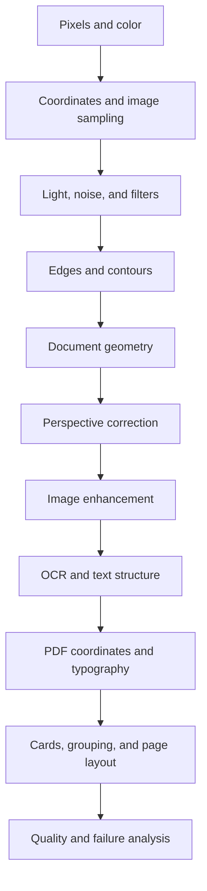
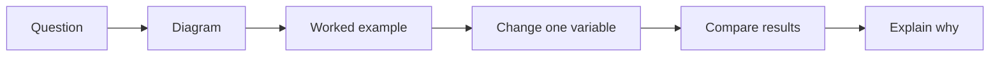
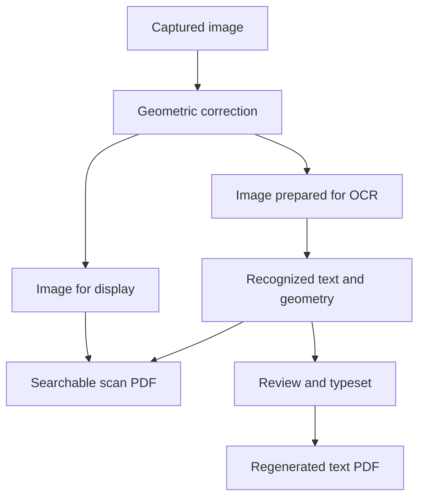
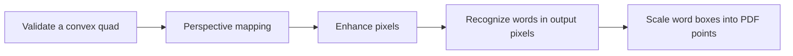
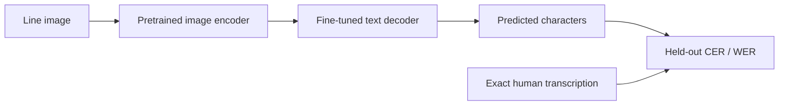
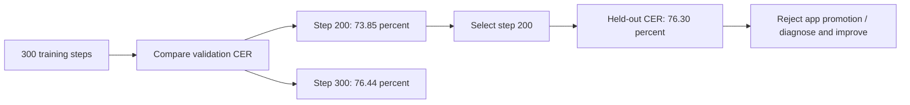
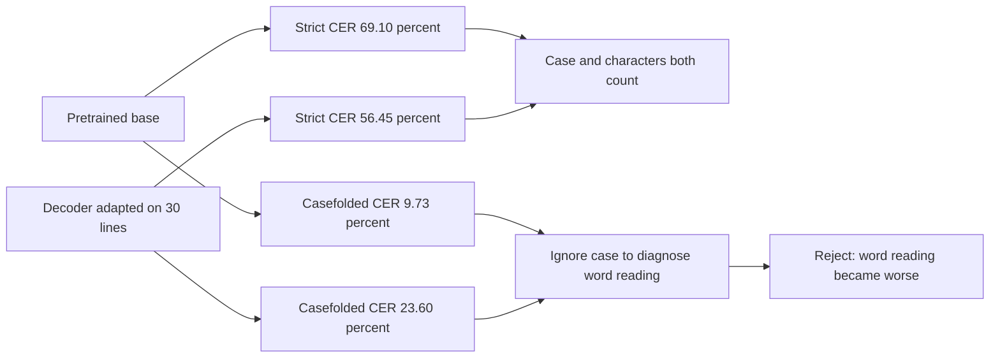

# Fundamentals - how the scanner works

Status: learning plan. Lessons and exercises below are planned, not completed.

This file owns concepts, diagrams, worked examples, experiments, and learning observations. Build tasks belong in [Backend.md](Backend.md); formal validation belongs in [Testing.md](Testing.md).

## 1. Learning map

Learn one concept, inspect one transformation, and explain one failure before moving on. Use Kotlin-based experiments when we begin implementation; a separate Python application is not required.

## 2. Lesson format

Every lesson uses the same short structure:

| Part | What we put here |
| --- | --- |
| Question | One problem the app must solve |
| Visual | Diagram or before/after image |
| Concept | A short explanation and essential vocabulary |
| Math | Only the formula needed, with a small numeric example |
| Experiment | Input, one changed variable, output to inspect |
| Failure | A case where the method breaks and why |
| Checkpoint | A question answered in the learner's own words |
| App connection | Relevant screen IDs and processing stage |

Do not mark a lesson understood merely because its code runs. Record the explanation and observations below.

## 3. Lesson syllabus

| ID | Concept | Experiment | Understanding checkpoint | Screens |
| --- | --- | --- | --- | --- |
| F01 | Pixels, channels, grayscale, image dimensions | Inspect a small RGB patch and its grayscale version | Explain what one pixel stores and what grayscale discards | S05, S15 |
| F02 | Coordinates, orientation, resize, interpolation | Resize a marked image and map one point back to the source | Explain why preview coordinates cannot be used directly on a full-resolution capture | S03, S04 |
| F03 | Exposure, focus, blur, noise, glare | Compare sharp, blurry, dark, and reflective captures | Explain what can be improved and what requires recapture | S03, S05 |
| F04 | Kernels, convolution, smoothing | Compare blur strengths on printed text | Explain the tradeoff between noise suppression and lost detail | S05, S15 |
| F05 | Gradients, edge thresholds, contours | Compare edge maps on clean and cluttered backgrounds | Explain why an edge is not automatically a paper boundary | S04, S15 |
| F06 | Polygons, corner ordering, candidate selection | Compare quadrilateral candidates and move their corners | Explain why the largest rectangle can be the wrong object | S04 |
| F07 | Homography and perspective | Map four tilted paper corners to a rectangle | Explain perspective correction versus a simple crop | S04, S15 |
| F08 | Histograms, contrast, thresholding, morphology | Compare original, grayscale, and thresholded small text | Explain why stronger enhancement can reduce OCR accuracy | S05, S15 |
| F09 | OCR detection, recognition, inference, reading order | Compare text blocks and boxes with a typed reference | Explain how finding text differs from reading and ordering it | S06 |
| F10 | PDF pages, text layers, fonts, coordinate transforms | Trace a recognized word onto a PDF page | Explain searchable scan versus regenerated text | S09-S11 |
| F11 | Card detection, classification, pairing, placement | Separate card regions, label sides, arrange a sheet | Explain why these are four different problems | S04, S07, S09 |
| F12 | Error measurement, robustness, generalization | Compare success and failure on previously unseen photos | Explain measured accuracy versus model confidence | All processing screens |

The syllabus covers classical vision and pretrained OCR inference. Training an OCR model is a later extension, not a requirement for the first scanner.

## 4. Math we will introduce gradually

| Concept | Only the math we need initially |
| --- | --- |
| Image arrays | Width, height, channel count, pixel indexing |
| Grayscale | Weighted combination of color channels |
| Filtering | Weighted sums over neighboring pixels |
| Gradients | Differences between neighboring intensities |
| Geometry | Points, distances, polygons, area, aspect ratio |
| Homography | A 3 x 3 projective transform and normalization |
| PDF layout | Scale, translation, rotation, margins, unit conversion |
| OCR evaluation | Character and word edit distance divided by reference length |

No mathematics is assumed mastered. Each formula gets a visual example when its lesson begins.

## 5. Three distinctions to understand

- Geometry changes where pixels belong; enhancement changes their values.
- OCR reads text; it does not automatically recreate the original design.
- A searchable scan preserves appearance; regenerated text is newly laid out.

## 6. Failure notebook

| Observation | Likely explanation | Experiment to try |
| --- | --- | --- |
| Wrong rectangular region selected | Background geometry outranks the paper | Inspect all candidates and adjust corners |
| Small characters disappear | Blur or thresholding removed detail | Compare with corrected original |
| White glare hides printed text | Capture lost character information | Recapture with a different angle or light |
| OCR boxes drift in export | Coordinate transforms or revisions disagree | Trace one word through every coordinate space |
| Card print has the wrong size | Pixel dimensions were mistaken for physical dimensions | Use known dimensions or explicit user input |

These are learning examples, not diagnosed bugs in an existing implementation.

## 7. Learning progress and observations

| Lessons | Status |
| --- | --- |
| F01-F12 | Planned; not yet taught or assessed |

For each completed exercise, append a short entry here with: lesson ID, input, changed variable, observation, explanation, remaining question, and next experiment. Link to images if needed; do not create extra Markdown notes.

## 8. References and boundaries

Use the official references maintained in [Architecture.md](Architecture.md). Follow the six-file documentation rule in [Project.md](Project.md). Formal test procedures and results stay in [Testing.md](Testing.md).

## Learn from the native pipeline

Trace `core/Geometry.kt`, `core/vision/OpenCvProcessor.kt` and `core/pdf/ScannerPdfExporter.kt`. Compare grayscale, edges and threshold output in S15. Check why crossing corners are rejected and why paragraph rewrites cannot reuse old word positions. Unit/device test cases are executable examples; broader real-photo accuracy must still be measured.

## Handwritten English recognition experiment

Training loss measures the next-token objective. CER/WER measure recognition errors against unseen transcriptions; low training loss alone does not prove better OCR. Split documents and, when known, writers before training. Keep validation for model selection and the test set for final measurement. TrOCR reads cropped lines; full-page line detection and polygon mapping are additional app requirements. Historical manuscript accuracy does not establish performance on modern notes or ID cards.

### Observation from the first real training run

The latest weights were worse on validation than an earlier checkpoint. Training loss still decreased. This illustrates why validation selects the checkpoint. The 40-line test contained 1,308 reference characters; 998 character edits give CER = 998 / 1,308 = 76.30%. WER can exceed 100% because inserted words count as additional errors.

The selected model improved on its pretrained baseline but still produced no exact held-out lines. Improvement and usable recognition are different acceptance questions. These are recorded experiment observations; the learner's F01-F12 understanding has not been assessed.

### Why one improved score can hide a regression

Changing `students` to `STUDENTS` can improve case matching. Omitting a word still harms transcription. Inspect both strict errors and a clearly labeled diagnostic; keep the agreed primary metric unchanged. These numbers come from 13 development-validation lines, not a representative final test.

An image encoder learns visual features; a decoder learns token sequences. Freezing the encoder saves compute but can limit adaptation. Training both parts is an experiment, not a guarantee: our 100-step encoder comparison still produced missing/repeated words. More varied, accurately labeled data is necessary.

### Training loss alignment correction - 15 October 2026

The first eight-line IAM learning check completed 160 updates but failed its fixed gate: CER rose from 20/323 (6.19%) to 49/323 (15.17%) even while loss fell. No checkpoint was saved/promoted and no longer training run was launched.

Source inspection and a tiny real VisionEncoderDecoder regression reproduction confirmed that installed Transformers 4.57.1 shifted decoder inputs once but dispatched a generic causal-LM loss that shifted target labels again. Thus the optimized token targets were misaligned with generation. `ml/seq2seq_training.py` now supplies explicit decoder inputs shifted once and computes same-position cross-entropy independently of the library's loss dispatcher. Both the main trainer and IAM diagnostic use it; site-packages and dataset labels are unchanged.

All 54 pipeline tests pass in the pinned environment. New tests cover perfect aligned token predictions, ignored padding, actual ViT/TrOCR wrapper forward equivalence to manual CE, and finite gradients. The previous custom training runs used the faulty objective, so their poor scores cannot establish that the architecture cannot learn these data; their checkpoints remain unpromoted. Pretrained inference baselines are unaffected by this training-code correction.

A single corrected eight-line check is prepared with the same data, learning rate, 160-step cap and unchanged gate. Its result is pending; confirming the loss defect does not itself establish successful learning or app readiness.

### ML-only scope and stricter exact-line target - 15 October 2026

User direction: keep work focused on ML and publish the model/source to GitHub once complete. The 75–80% goal is interpreted conservatively as strict case-sensitive completely correct lines: 75% minimum, 80% stretch. Character error rate, word error rate and exact-line rate remain separate. Historical policy/results are preserved; `ml/iam-exact-line-policy-v2.json` records the new target and validation selection rule (highest exact-line rate, tie-break lower CER). Current candidate has 66.15% exact lines on the consumed v1 final test and is not accepted for publication. No commit/push or weight upload has occurred for this stage.

Validation-only diagnosis on 881 lines: 564 exact, 242 text-recognition errors, 49 punctuation/spacing-only mismatches, 11 case-only, nine whitespace-only and six combined formatting-only. Reaching 75% needs 97 additional exact validation lines; reaching 80% needs 141. These diagnostic categories never replace strict headline scores. Even correcting all formatting-only failures is insufficient for 75%.

One bounded next experiment is prepared: compare beam-4 decoding for the frozen original and update-2,000 checkpoints against their saved greedy validation results, with identical source labels and maximum 128 new tokens. This changes decoding, not weights, and selects by the new exact-line criterion using validation only. The consumed final test is excluded from this stage; fresh final acceptance needs another locked holdout or explicitly disclosed benchmark reuse. No 75–80% success is promised. HUD configuration tracks this validation comparison. All 57 pipeline tests pass in the pinned environment.

For later accepted publication, source changes will be batched on main. Dataset archives, reference frames and raw samples remain excluded. Large model weights should be distributed as a versioned GitHub Release asset with tokenizer/processor configuration, checksums and an honest evaluation summary, after redistribution requirements are verified. Model acceptance and publication are not yet complete.
