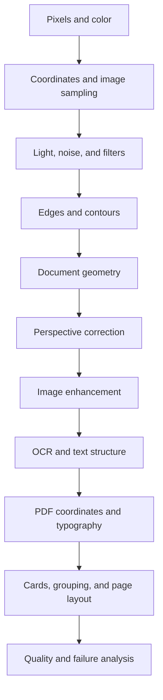
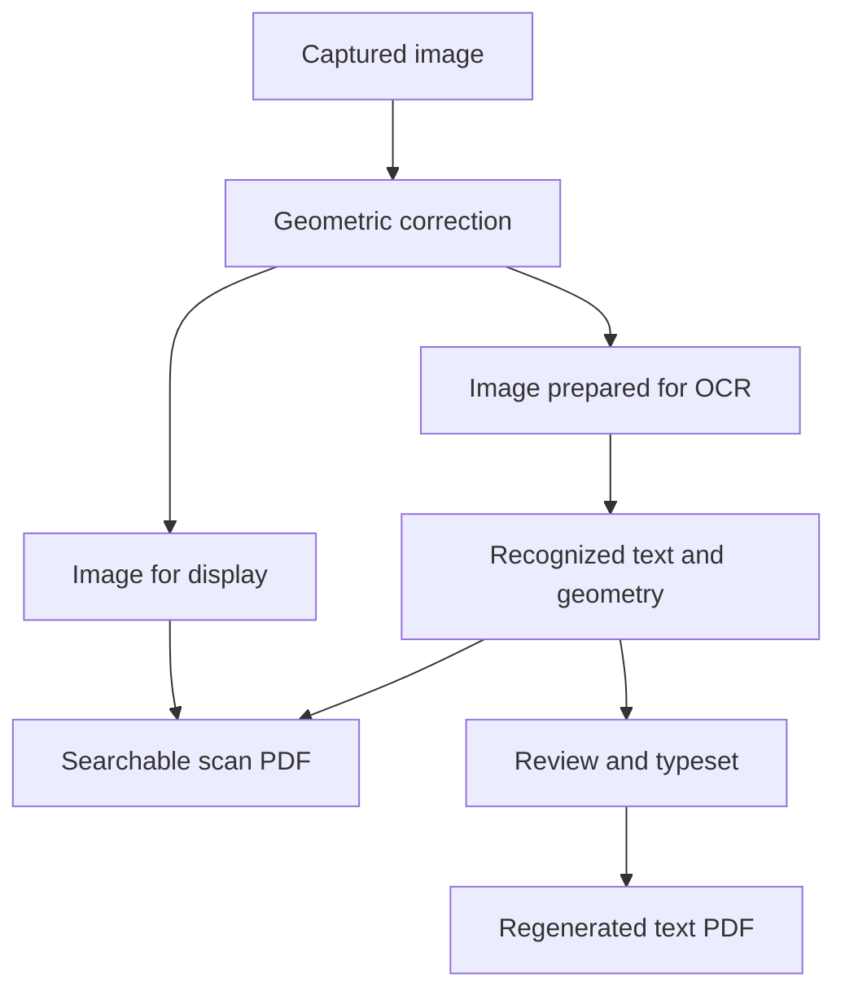

# Fundamentals - how the scanner works

Status: learning plan. Lessons and exercises below are planned, not completed.

This file owns concepts, diagrams, worked examples, experiments, and learning observations. Build tasks belong in [Backend.md](Backend.md); formal validation belongs in [Testing.md](Testing.md).

## 1. Learning map

Learn one concept, inspect one transformation, and explain one failure before moving on. Use Kotlin-based experiments when we begin implementation; a separate Python application is not required.

## 2. Lesson format

Every lesson uses the same short structure:

| Part | What we put here |
| --- | --- |
| Question | One problem the app must solve |
| Visual | Diagram or before/after image |
| Concept | A short explanation and essential vocabulary |
| Math | Only the formula needed, with a small numeric example |
| Experiment | Input, one changed variable, output to inspect |
| Failure | A case where the method breaks and why |
| Checkpoint | A question answered in the learner's own words |
| App connection | Relevant screen IDs and processing stage |

Do not mark a lesson understood merely because its code runs. Record the explanation and observations below.

## 3. Lesson syllabus

| ID | Concept | Experiment | Understanding checkpoint | Screens |
| --- | --- | --- | --- | --- |
| F01 | Pixels, channels, grayscale, image dimensions | Inspect a small RGB patch and its grayscale version | Explain what one pixel stores and what grayscale discards | S05, S15 |
| F02 | Coordinates, orientation, resize, interpolation | Resize a marked image and map one point back to the source | Explain why preview coordinates cannot be used directly on a full-resolution capture | S03, S04 |
| F03 | Exposure, focus, blur, noise, glare | Compare sharp, blurry, dark, and reflective captures | Explain what can be improved and what requires recapture | S03, S05 |
| F04 | Kernels, convolution, smoothing | Compare blur strengths on printed text | Explain the tradeoff between noise suppression and lost detail | S05, S15 |
| F05 | Gradients, edge thresholds, contours | Compare edge maps on clean and cluttered backgrounds | Explain why an edge is not automatically a paper boundary | S04, S15 |
| F06 | Polygons, corner ordering, candidate selection | Compare quadrilateral candidates and move their corners | Explain why the largest rectangle can be the wrong object | S04 |
| F07 | Homography and perspective | Map four tilted paper corners to a rectangle | Explain perspective correction versus a simple crop | S04, S15 |
| F08 | Histograms, contrast, thresholding, morphology | Compare original, grayscale, and thresholded small text | Explain why stronger enhancement can reduce OCR accuracy | S05, S15 |
| F09 | OCR detection, recognition, inference, reading order | Compare text blocks and boxes with a typed reference | Explain how finding text differs from reading and ordering it | S06 |
| F10 | PDF pages, text layers, fonts, coordinate transforms | Trace a recognized word onto a PDF page | Explain searchable scan versus regenerated text | S09-S11 |
| F11 | Card detection, classification, pairing, placement | Separate card regions, label sides, arrange a sheet | Explain why these are four different problems | S04, S07, S09 |
| F12 | Error measurement, robustness, generalization | Compare success and failure on previously unseen photos | Explain measured accuracy versus model confidence | All processing screens |

The syllabus covers classical vision and pretrained OCR inference. Training an OCR model is a later extension, not a requirement for the first scanner.

## 4. Math we will introduce gradually

| Concept | Only the math we need initially |
| --- | --- |
| Image arrays | Width, height, channel count, pixel indexing |
| Grayscale | Weighted combination of color channels |
| Filtering | Weighted sums over neighboring pixels |
| Gradients | Differences between neighboring intensities |
| Geometry | Points, distances, polygons, area, aspect ratio |
| Homography | A 3 x 3 projective transform and normalization |
| PDF layout | Scale, translation, rotation, margins, unit conversion |
| OCR evaluation | Character and word edit distance divided by reference length |

No mathematics is assumed mastered. Each formula gets a visual example when its lesson begins.

## 5. Three distinctions to understand

- Geometry changes where pixels belong; enhancement changes their values.
- OCR reads text; it does not automatically recreate the original design.
- A searchable scan preserves appearance; regenerated text is newly laid out.

## 6. Failure notebook

| Observation | Likely explanation | Experiment to try |
| --- | --- | --- |
| Wrong rectangular region selected | Background geometry outranks the paper | Inspect all candidates and adjust corners |
| Small characters disappear | Blur or thresholding removed detail | Compare with corrected original |
| White glare hides printed text | Capture lost character information | Recapture with a different angle or light |
| OCR boxes drift in export | Coordinate transforms or revisions disagree | Trace one word through every coordinate space |
| Card print has the wrong size | Pixel dimensions were mistaken for physical dimensions | Use known dimensions or explicit user input |

These are learning examples, not diagnosed bugs in an existing implementation.

## 7. Learning progress and observations

| Lessons | Status |
| --- | --- |
| F01-F12 | Planned; not yet taught or assessed |

For each completed exercise, append a short entry here with: lesson ID, input, changed variable, observation, explanation, remaining question, and next experiment. Link to images if needed; do not create extra Markdown notes.

## 8. References and boundaries

Use the official references maintained in [Architecture.md](Architecture.md). Follow the six-file documentation rule in [Project.md](Project.md). Formal test procedures and results stay in [Testing.md](Testing.md).

## Learn from the native pipeline

Trace `core/Geometry.kt`, `core/vision/OpenCvProcessor.kt` and `core/pdf/ScannerPdfExporter.kt`. Compare grayscale, edges and threshold output in S15. Check why crossing corners are rejected and why paragraph rewrites cannot reuse old word positions. Unit/device test cases are executable examples; broader real-photo accuracy must still be measured.
