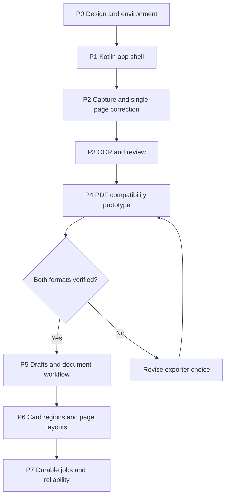
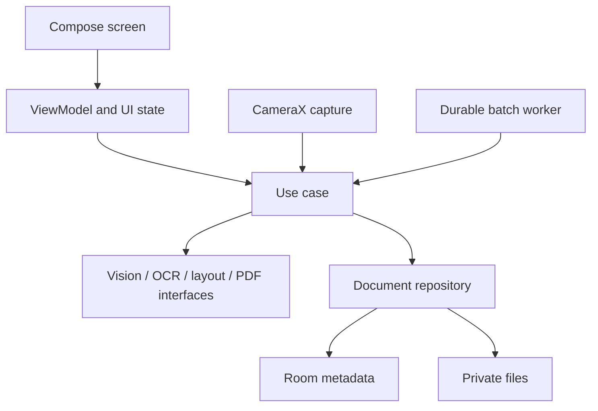
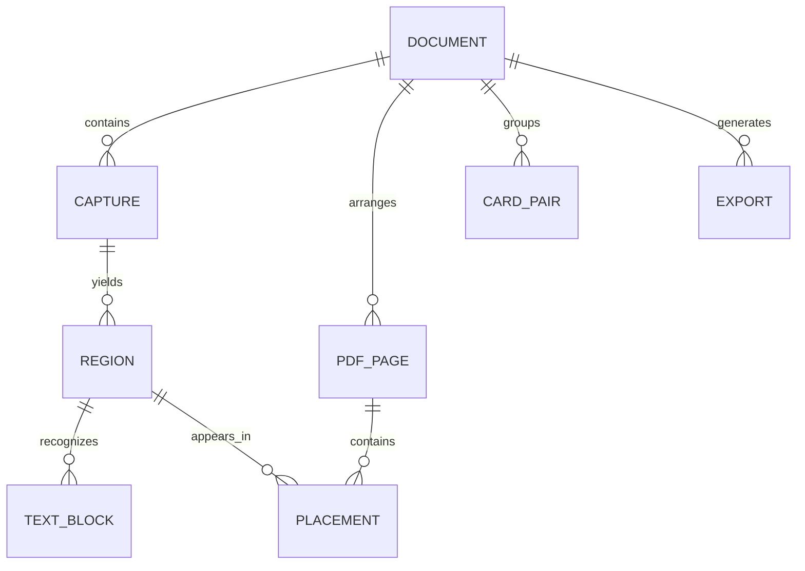
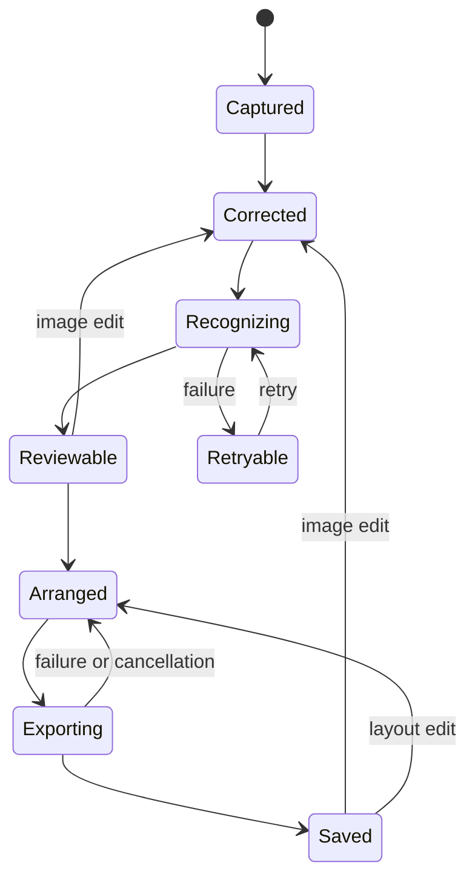
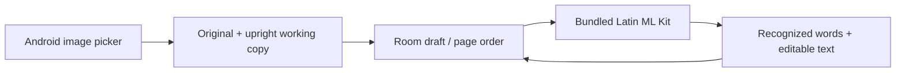

# Implementation - how we will build the scanner

Status: Kotlin implementation started on 14 October 2026 with user authorization. `android/` contains the first native integration slice; the first APK/JVM/lint build passed; device acceptance remains a separate gate.

This file owns implementation milestones, package responsibilities, data contracts, dependencies, technical decisions, and progress. System design lives in [Architecture.md](Architecture.md), screen behavior in [Frontend.md](Frontend.md), lessons in [Fundamentals.md](Fundamentals.md), and verification in [Testing.md](Testing.md).

## 1. Entry criteria

- Review the 15 screen designs, shared components, and navigation.
- Confirm Android tooling and a physical test device.
- Select the initial OCR scripts and representative sample documents.
- Review both PDF outputs and both ID-card journeys.
- Schedule the PDF compatibility prototype before committing to an export engine.

Do not scaffold the application until the user starts the build phase.

## 2. Delivery map



| Phase | Concrete result | Screens | Learning link | Completion evidence |
| --- | --- | --- | --- | --- |
| P0 | Reviewed designs, chosen device/scripts, representative samples | All designs | F01-F02 | Readiness decisions recorded |
| P1 | Compose navigation and shared UI using clearly labeled sample state | S01-S15 | F01-F02 | Primary routes and editor returns work |
| P2 | Capture/import, manual crop, automatic candidates, correction, enhancement | S02-S05, S15 | F03-F08 | One real page is corrected without clipping |
| P3 | OCR boxes, reviewed text, script selection, retries | S06 | F09 | Output compared with typed reference |
| P4 | One-page searchable scan and regenerated text exports | S10-S11 prototype | F10 | Search, copy, Unicode, and alignment checked in two readers |
| P5 | Persistent drafts, library, organizer, search, export/save/share | S01, S08-S14 | F10 | Multipage draft and saved export survive reopening |
| P6 | Multiple regions, manual front/back pairs, card templates, overflow | S04, S07-S09 | F11 | Both complete card journeys demonstrated |
| P7 | Resumable batches, cancellation, recovery, bounded image memory | Cross-cutting | F12 | Reliability checks recorded in Testing.md |

Package, data, and revision contracts are established from P1; persistence becomes user-complete in P5. Revisit earlier phases if a validation gate exposes a design problem. No delivery dates are assigned yet.

## 3. Package responsibilities

One app module initially. Keep package boundaries; split Gradle modules only when justified.

```text
app/
  feature/
    library/       library, search, saved document details
    capture/       setup, camera, import
    editor/        corners, enhancement, organizer, learning lab
    ocr/           recognition review and corrections
    cards/         labels, front/back pairing, card layouts
    export/        options, preview, save/share
    settings/      supported defaults
  core/
    vision/        image geometry and processing
    ocr/           OCR engine interface and adapter
    pdf/           layout and PDF export interface
  data/            document repository, Room, file storage
```



Compose renders state and emits actions. Coroutines run interactive processing off the UI thread. WorkManager is reserved for durable batches. Repository operations own persisted document state.

## 4. Processing contracts

| Component | Input | Output | Required behavior |
| --- | --- | --- | --- |
| Capture/import | Camera image or selected URI | App-owned source reference, dimensions, orientation | Handle denied permission, cancelled picker, unreadable source |
| VisionProcessor | Source revision and edit recipe | Regions, corrected image reference, transform metadata | Support manual corners and multiple regions; preserve original |
| OcrEngine | Corrected region revision and supported script | Text blocks, words, polygons, available confidence | Return explicit no-text/failure states; preserve source linkage |
| Text review | OCR result and user edits | Reviewed text plus geometry/alignment status | Keep short corrections positioned where possible; flag large rewrites |
| PageLayoutEngine | Regions, confirmed pairs, page settings | Ordered pages with placement transforms | Preserve aspect ratio; prevent overlap; paginate overflow |
| PdfExporter | Output mode, reviewed content, placements, revisions | Validated completed file reference or failure | Never replace a valid export with a partial file |
| DocumentRepository | Document edits and processing results | Persisted draft/export state | Reject results for stale revisions |

Exact Kotlin signatures and library versions will be selected during implementation; these are conceptual contracts.

## 5. Data model



| Record | Essential fields |
| --- | --- |
| Document | ID, title, scan mode, timestamps, document revision |
| Capture | Original URI, orientation, source dimensions |
| Region | Source capture, four corners, rotation, enhancement recipe, image revision |
| TextBlock | Region revision, text, word/polygon geometry, order, available confidence, review revision |
| CardPair | Front region, optional back region, user-confirmed label |
| PdfPage | Page size, margins, template, order |
| Placement | Region, destination rectangle, scale, rotation |
| Export | Output mode, source revision snapshot, status, completed file URI |

Room stores metadata and geometry; images and PDFs stay in private files. Several card regions may reference one capture. Cache cleanup must not remove originals required by existing drafts.

## 6. Edits, state, and background work



| Change | Recompute | Retain |
| --- | --- | --- |
| Crop, rotation, or OCR-input image changes | Corrected input as needed, OCR, PDF | Original capture and prior saved export |
| Display-only styling | Visible image and scan PDF | OCR if its input pixels and geometry are unchanged |
| OCR script changes | OCR and dependent export | Original and corrected source |
| Reviewed text changes | Dependent PDF; revalidate searchable alignment | Corrected image and original OCR result |
| Pairing, page order, margins, layout | PDF placement/export | Region images and OCR |
| Filename only | Export metadata/name | Image processing and OCR |

Store source dimensions and transforms: orientation -> source pixels -> corrected region -> OCR geometry -> PDF placement. Screen coordinates must not become stored image geometry.

Autosave draft edits. Use source-revision checks so an old job cannot overwrite a newer edit. Write new exports to a temporary destination, publish only after success, and retain previous valid exports on failure. Resume or retry interrupted batches without duplicating completed results.

Document deletion removes app-owned originals, derivatives, records, and exports. Copies shared outside the app remain outside the document store.

## 7. Technical decision register

| Decision | Current position | Resolve when |
| --- | --- | --- |
| Application stack | Kotlin, Compose, CameraX, OpenCV, ML Kit, Room | Verify compatible versions during P0/P1 |
| PDF engine | Open pending searchable-text compatibility prototype | P4; before production exporter integration |
| Android/device baseline | Not selected | P0 |
| OCR scripts | Latin first proposed; user requirements to confirm | P0/P3 |
| Card families | Generic regions and manual labels first; named types to confirm | P6 |
| Regenerated layout | Simple single-column paragraphs initially | P4 |
| Physical-size printing | Only when dimensions are known or entered | P6 |
| Dependency versions and permissions | Not pinned | Verify from official sources during setup |
| Performance targets | Measure representative baseline before assigning thresholds | P2 onward; finalize in Testing.md |

Use a ready OCR model first. Custom model training and automatic card pairing remain later extensions. A ready-made scanning SDK can be a comparison baseline; custom processing remains the learning path.

## 8. Progress log and completion rule

| Phase | Status | Evidence |
| --- | --- | --- |
| P0 | Frontend approved; local SDK/JDK verified | Physical test device selection pending |
| P1 | In progress: minimal native integration shell | Library/import/review surface authored; full S01-S15 parity pending |
| P2-P3 | First import/OCR integration authored | Real adapter code; device validation pending |
| P4-P7 | Not completed | Persistence contracts started early; PDF, camera/CV, full card workflows and durable jobs remain |

Record future entries here: date, phase, task, decision/change, source/code reference, verification link, blocker, next action. Detailed test outcomes belong in [Testing.md](Testing.md), not duplicate test reports.

A phase is complete only when its working result and verification evidence exist. Planned work, UI mockups, and successful compilation alone do not prove scanner accuracy.

Update this existing file. Follow the six-file rule in [Project.md](Project.md); do not create extra task, status, or implementation Markdown files.


## Frontend prototype checkpoint - 14 October 2026

The design phase produced `design/index.html` (wireframe/workspace) and `design/prototype/` (interactive phone design). This work does not complete P1: no Kotlin/Compose app shell exists yet.

Implemented for design review: local draft state, saved sample library, image import, editable crop handles, simulated processing/retry/cancel, OCR text edits, manual side/pair labels, reorder/delete, page templates with overflow, both export-preview styles, search, settings, onboarding, and a brief logo boot animation.

Native CameraX, OpenCV, ML Kit, Room, Android WorkManager, actual PDF text layers/files, Android sharing, and native lifecycle/accessibility behavior remain future implementation work. Use the reviewed prototype as the visual reference when P1 begins.


## Native foundation - 14 October 2026



| Implemented source | Purpose |
| --- | --- |
| `android/app/.../data/PrivateImageStore.kt` | Retain original, apply decoder orientation, cap working copy at 3000 px; reject oversized/partial images |
| `ScannerDatabase.kt` / `DocumentRepository.kt` | Room documents, captures, regions, transactional edits, stale-result rejection and retryable deletion tombstones |
| `MlKitOcrEngine.kt` | Real bundled Latin OCR, ordered words and upright pixel polygons; no simulated results |
| `core/Models.kt` | Revision/order validation and whole-pair card pagination |
| `feature/ScannerViewModel.kt` / `MainActivity.kt` | Minimal native import/library/text-review integration, useful controls only |

Initial build baseline: AGP 8.13.2, Gradle 8.13 (checksum pinned), Kotlin/Compose compiler 2.2.21, Compose BOM 2025.08.01, Room 2.8.4 with kapt, ML Kit Latin 16.0.1, Java 17 bytecode. Local build uses Android Studio JDK 21 and installed SDK 36. These are pinned compatible baseline choices, not a latest-version claim. Min SDK 28 is provisional for the first ImageDecoder-based importer; target/compile SDK 36. Revisit device support before release. No web server or cloud backend is required for this on-device architecture.

The native shell is an engineering integration surface, not the complete approved 15-screen UI. It does not replace `design/`. No CameraX capture, OpenCV correction, physical card placement, export engine, real PDF file, sharing or WorkManager batch exists yet. The card packing function validates grouping/count only; PDF rectangle geometry remains future work.

Import limits: 20 MB encoded source, 80 million source pixels, longest upright working side 3000 pixels. One original capture currently yields one region. OCR geometry refers to the upright working image; source-to-crop/PDF transforms come with correction/export. Reviewed text retains original recognized geometry separately and must not be treated as aligned searchable text without validation.

Run from project root: `python3 tools/verify_android.py`. It builds the debug APK, runs JVM tests and lint, and compiles the device-test APK. Structured outcome is `output/android/verification.json`; device tests require a connected emulator/phone and a separate `./gradlew :app:connectedDebugAndroidTest` invocation from `android/`. Open `android/` in Android Studio. Local `sdk.dir` is ignored; other hosts should set their own SDK path.

Official dependency references: [AGP/Kotlin compatibility](https://developer.android.com/build/kotlin-support), [Room setup](https://developer.android.com/jetpack/androidx/releases/room), [bundled OCR setup](https://developers.google.com/ml-kit/vision/text-recognition/v2/android). Next integration: run the import/OCR round trip on a device, then add manual perspective correction before PDF work.
