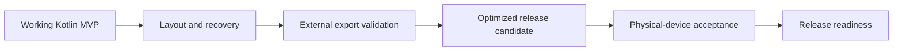
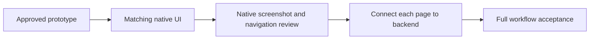

# Folio - project reference

Folio is a native Android scanner built in Kotlin and Jetpack Compose. Supports document correction, on-device OCR, searchable scan PDFs, regenerated text PDFs, front/back card pairing, and multiple-card page layouts.

Current phase: publish the current native-app and experimental handwriting-ML source with explicit acceptance boundaries, then continue integration and reliability work. The approved native UI and local browser reference are preserved. Custom OCR remains experimental; Google Play publication is deferred.

## Documentation rules

- `/docs` contains exactly the six Markdown files listed below, and nothing else.
- All project documentation changes must update these six existing files.
- Keep exactly six Markdown files in `/docs`. The root `README.md` is the sole additional Markdown file, explicitly authorized for the public project overview on 15 October 2026. Do not create other Markdown files, including AGENTS, changelogs, task notes or generated Markdown exports.
- Put new topics under the appropriate existing file. Add sections instead of files.
- Generated PDFs remain outside `/docs`; they are reference snapshots, not editable documentation sources.
- Scripts must not generate Markdown files or add files to `/docs`.

## Six-file map

| File | Owns |
| --- | --- |
| [Project.md](Project.md) | Scope, project status, documentation rules, file map |
| [Architecture.md](Architecture.md) | System architecture, data flow, screen map, technical decisions |
| [Frontend.md](Frontend.md) | Frontend design prompt, screen behavior, prototype handoff |
| [Fundamentals.md](Fundamentals.md) | Computer vision concepts and learning exercises |
| [Backend.md](Backend.md) | Kotlin implementation sequence and technical validation gates |
| [Testing.md](Testing.md) | Quality checks, acceptance criteria, validation evidence |

## Source ownership

Use Architecture for system decisions and Frontend for detailed screen design. Fundamentals explains concepts; Backend tracks engineering work; Testing owns verification. Update affected existing files together when decisions change.

## Existing artifact

Architecture PDF (local artifact: `output/pdf/Architecture.pdf`): 11-page design-baseline snapshot from 14 October 2026. Markdown is the current source; regenerate the PDF after substantive architecture changes when requested.

## Current design handoff

- Wireframe and interactive prototype (local artifact: `design/index.html`)
- [Frontend design specification](Frontend.md)
- [Prototype verification](Testing.md)

The prototype contains 15 functional screens plus logo boot and two first-run onboarding states. It is a browser review artifact. Native capture, correction, persistence, OCR and both PDF exports work under `android/`; build and device evidence are tracked in Testing.md. Full native visual parity and release validation remain unfinished.

## Permanent design website

The user explicitly requested retaining the website on 14 October 2026. Keep `design/`, its prototype, assets, concepts, and reference screens in this project alongside the future Android app. Do not remove or replace the website when Kotlin implementation starts.

Double-click `Start Scanner Design.command` to start/open the website. Alternatively run `python3 tools/serve_design.py --open` from the project root. Default URL: `http://127.0.0.1:8770`. The launcher reuses an existing matching preview. Closing the server does not remove any website files or assets; use the launcher to reopen it.

## Public repository

Product/repository name: **Folio**. GitHub: https://github.com/InsaneCoder789/Folio. The local workspace remains `OCR Scanner`; no project files were moved. Initial Android application ID remains `com.rohanc.ocrscanner` to preserve install identity. Historical screen artwork and architecture PDF retain their original working title. Credentials, local SDK paths, build outputs, signing keys, logs and local integration metadata stay out of Git.

## Native workflow expansion

The native MVP implements all 15 functional routes plus first-run entry, CameraX capture, manual/automatic boundaries, OpenCV correction and enhancement, text review, manual card pairing, PDF placement, actual searchable/text PDF export, preview, save/share, local search/settings and an optional processing lab. WorkManager handles resumable OCR batches. The latest recorded native gate passed 23 JVM and 27 API-34 checks. The permanent website remains alongside the Android app.

The current backend gate passed build/lint, 23 JVM checks and 27 API-34 device checks. The working debug APK and verification evidence are listed in [Backend.md](Backend.md) and [Testing.md](Testing.md). Physical-phone and release validation are next.

## Active completion goal

Finish the remaining native app work and show Folio in a visible emulator. Preserve the design website. Push verified changes directly to `main`; create PRs only when requested.

| Gate | Required evidence | Current state |
| --- | --- | --- |
| Visible app | Booted, installed, foreground app in a visible emulator | Passed on Folio_API34; onboarding displayed |
| Native UI finish | All routes, small/large text, landscape, navigation, accessible crop controls | In progress |
| Recovery | Recreation/process recovery, cancellation, large batches and storage failure checks | Partial; core revisions and atomic imports passed |
| External export | Save through Android Files; share/open grants consumed by a second app | Implemented; integration checks pending |
| Release candidate | Shrunk build, measured per-device package, signing configuration and runtime check | Pending |
| Physical quality | Consented photos, lighting/blur/card cases, measured OCR errors and timings | Needs physical phone and representative samples |
| Release packaging | Final privacy disclosures, signed release, support/API coverage and distribution | Pending; no store publication requested |

Scope extensions remain explicit: non-Latin/handwriting OCR, complex page reconstruction, automatic card-type identification/pairing and known-size card printing are not implemented. They are later features; they must not be silently counted as finished.

## UI-first correction - 14 October 2026

The user rejected the initial generic native form layout. The approved permanent prototype is the visual authority: `design/prototype/`, its 15 screen frames and two onboarding states. Translate that design into Compose before expanding backend behavior.

Keep the existing backend and unfinished release/recovery work. Do not resume those gates as a substitute for fixing the UI. The earlier broad goal remains paused; this requested UI correction is the current work. Push completed, verified changes directly to main.

## Visible tester policy - 15 October 2026

Use only the user's already-running **Pixel_9_Pro** emulator (`emulator-5554`, currently API 37) for this UI work. Keep tests visible so the user can watch. Do not start another emulator, run a headless emulator, change its display configuration, wipe its data, or stop the user's Pixel instance.

Run `python3 tools/verify_android_visible.py --serial emulator-5554`. This installs with replacement, runs instrumentation directly, records actual results and leaves the same emulator open in native UI review. The old isolated-AVD runner is retained as historical tooling; it is not the authorized workflow for this work.

Current UI delivery: all 15 native routes plus two onboarding steps implemented against the approved prototype; 34 device tests and 23 JVM tests passed on the existing Pixel 9 Pro. See Frontend.md and Testing.md. User acceptance of this native pass precedes the next page-by-page backend increment.

## Repository policy - 15 October 2026

- Keep only `main`, locally and on GitHub. Both old feature/fix branches were deleted. A private local Git bundle in `.git/folio-branches-before-cleanup.bundle` preserves their history.
- Batch related changes into substantial, verified milestones; commit and push those batches directly to `main`. Do not commit or push every individual edit. No feature branches or PRs unless explicitly requested.
- Use formal, factual imperative commit subjects and a concise body explaining the behavior, rationale and actual validation. Batch a completed milestone; do not create a commit for every edit.
- Rewrite published history only when explicitly requested. On 15 October 2026 the user requested all 13 existing messages normalized, starting with `initial commit`; this was completed with unchanged file trees, topology, authors, dates and pending edits. Preserve unrelated dirty work.
- The current active objective covers handwriting training and frontend/backend/database/device-file acceptance. Preserve the full scope and report unverified gates explicitly.

## Source repository contents - 15 October 2026

GitHub contains the Kotlin app, required runtime resources, tests, build configuration, verification tools and these six documentation files. Browser reference HTML, mockups, UI frames, screenshots, exported sample PDFs and generated reports are local-only under ignored `design/` and `output/`. The existing local website and launcher remain available; fresh clones do not include them. The app logo, onboarding artwork and licensed fonts are required runtime resources and remain versioned.

Before committing, run `python3 tools/verify_repository.py`. The installed local pre-commit hook runs this check automatically, including attempts to force-add ignored HTML, reference folders or generated outputs. New clones must install their own hook; the tracked verification script is portable. Use neutral, factual commit descriptions; review staged filenames and the commit message before pushing.

The `Repository contents` GitHub workflow runs the same check on every push to `main`. It also enforces the six-file documentation boundary. Local isolated-index tests verify that force-added reference files and extra Markdown files are rejected without changing the working index.

## Working-state review - 15 October 2026

The user requests larger cohesive commits and grouped pushes. The non-ML backend increment remains local while validation finishes; no commit/push is requested for this review.

Implemented: all 15 native screens and onboarding; CameraX/import; manual crop and OpenCV processing; Room v3/private-file drafts; organizer and local search; manual card labels and layouts; both PDF exporters and reader/save/share adapters; preferences and processing lab. Bundled Latin ML Kit OCR is integrated. Custom handwritten-English training is now active; the first experimental checkpoint fails quality acceptance and remains outside the app. Automatic ID classification remains incomplete.

Verified installed baseline: 49 native tests, 23 JVM tests and lint passed, including native PDF output, storage boundaries and launcher re-entry. The corrected real setup process-death probe passed separately. The newer accessible-crop build passes compilation/JVM/lint, but its 51-test installation is blocked by emulator storage. The user chose continuing model work while leaving the Pixel unchanged.

Manual external evidence: both synthetic PDF output modes saved through Android Files and opened in the external Google PDF reader; searchable text lookup returned one match. The share chooser opened without sending to a recipient. Required remaining gates: final backend regression, other document/job recovery and stress cases, landscape/crop accessibility, external filename recheck, optimized runtime validation, physical-device/representative-photo quality and release signing/distribution preparation. The handwritten recognizer also needs acceptable measured quality and complete on-device integration.

Library integration uses the user-selected Android PdfDocument API for visible PDF content, ML Kit for OCR and PDFBox for invisible text/validation. The native writer passed its device gates; no claim of PdfDocument-provided OCR is made.

Handwriting scope selected by the user: handwritten English. Backend.md now contains the requirement-by-requirement source/test audit and open gates. Replace the earlier rough percentage with that acceptance checklist when reporting completion. New backend fixes and documentation remain local for the next verified batch.

Current active objective: train/evaluate handwritten English recognition and finish frontend, backend, database and device-file validation. All 42 ML pipeline checks pass. The completed 100-step base decoder pilot passes artifact verification and exact fresh-reload prediction comparison, but remains outside the app: strict validation CER improved to 56.45% while case-insensitive word reading regressed. The encoder-adaptation comparison also completed but remains unsuitable. The pinned mobile-focused baseline measured 4.14% strict CER on the curated 13-line validation subset; the separate 15-line expansion measured 5.70% strict CER. Host ONNX export and smoke checks passed; all 28 reviewed real-line predictions preserve exact Paddle parity on host and the existing Pixel standalone runtime. Representative final accuracy and device integration remain unverified. The larger historical corpus completed and independently verified at 1,966 train / 183 validation / 187 test lines. Independent final testing, full-page/mobile integration and all listed device gates remain open. Batch only verified milestones into commits.

Latest acceptance checkpoint: Kotlin detector source passes 33 JVM tests/lint/build; its Pixel-map gate is next. The larger 500-step custom training completed with no validation improvement, retained the pretrained baseline and independently verified 15.97% CER on its historical test subset. Full-page detector/recognizer integration, installed UI/database/worker regressions, representative final quality and release checks remain open.

### Current IAM checkpoint - 15 October 2026

Prepared: original-archive IAM adapter, custom deterministic writer separation, sealed selection manifest and fixed CER/WER/exact-line gates. Verified: 48 pipeline tests in the pinned ML environment. Blocked: registered IAM line/XML archives are not available; publisher timed out and Microsoft's published archive rejected access. Not started: IAM training. Not achieved: a suitable custom handwriting model or full-page app integration. Dataset access is the next required input, not more storage.

### IAM archive preparation update - 15 October 2026

The metadata-access blocker is resolved for the supplied `/Users/rohanc/Downloads/archive.zip`: downloaded `forms.txt` and `lines.txt` from the Kaggle `maxicode/iam-handwriting` listing match all 1,539 source page IDs and provide 13,353 annotated lines. Original metadata hashes are pinned in `ml/prepare_iam_forms.py`; original terms remain distinct from mirror license labels. XML is no longer required for this ASCII-based import.

The new bounded ZIP-to-line adapter checks writer folders, page dimensions, crop bounds, archive CRCs, image hashes and cross-split leakage. It publishes atomically, preserves source labels (converting IAM `|` separators to spaces), and generates training-only review boards. Fifty pipeline tests pass in the pinned ML environment, including synthetic end-to-end archive import and failed-publication cleanup. Actual corpus preparation and visual review are pending; no IAM training or model-readiness result is claimed yet. The next required gate is visual crop/label review, followed by a small training-only learning diagnostic before longer fine-tuning.

### IAM prepared corpus and bounded learning diagnostic - 15 October 2026

Preparation completed: 13,353 line crops from 1,539 pages, with 11,444 training lines (545 writers), 881 validation lines (53 writers), and 1,028 test lines (59 writers). Archive CRCs, coordinate bounds, metadata writer matches and cross-role leakage checks passed. This is the custom writer partition, not the official IAM benchmark.

The assistant viewed all three training-only boards (24 crop/transcription pairs) and recorded a sampled visual review bound to the board and corpus hashes. Neighbouring ink and unusual source punctuation remain documented; no transcription edits were made. This does not certify the complete corpus.

`ml/iam_learning_check.py` prepares one diagnostic on eight explicitly reviewed TRAINING lines, using the pinned TrOCR-base foundation, frozen encoder, decoder AdamW learning rate 5e-6, accumulation 4, maximum 160 updates, evaluation every 20, and a 45-minute runtime check. It requires training CER <=2%, no CER regression against the same-line baseline, and at least 20% loss reduction before allowing consideration of longer fine-tuning. Validation/test decoding is prohibited. It saves no promotable checkpoint, and cannot establish generalization, Android compatibility, or app readiness. A failure stops the next training stage; no automated experiment loop is scheduled.

All 52 pipeline tests pass in the pinned ML environment, including diagnostics selection and failure-gate checks. Diagnostic execution/results are tracked separately; this entry does not claim it has passed.

### Training loss alignment correction - 15 October 2026

The first eight-line IAM learning check completed 160 updates but failed its fixed gate: CER rose from 20/323 (6.19%) to 49/323 (15.17%) even while loss fell. No checkpoint was saved/promoted and no longer training run was launched.

Source inspection and a tiny real VisionEncoderDecoder regression reproduction confirmed that installed Transformers 4.57.1 shifted decoder inputs once but dispatched a generic causal-LM loss that shifted target labels again. Thus the optimized token targets were misaligned with generation. `ml/seq2seq_training.py` now supplies explicit decoder inputs shifted once and computes same-position cross-entropy independently of the library's loss dispatcher. Both the main trainer and IAM diagnostic use it; site-packages and dataset labels are unchanged.

All 54 pipeline tests pass in the pinned environment. New tests cover perfect aligned token predictions, ignored padding, actual ViT/TrOCR wrapper forward equivalence to manual CE, and finite gradients. The previous custom training runs used the faulty objective, so their poor scores cannot establish that the architecture cannot learn these data; their checkpoints remain unpromoted. Pretrained inference baselines are unaffected by this training-code correction.

A single corrected eight-line check is prepared with the same data, learning rate, 160-step cap and unchanged gate. Its result is pending; confirming the loss defect does not itself establish successful learning or app readiness.

### Corrected learning check passed; one IAM adaptation run prepared - 15 October 2026

The corrected eight-line learning diagnostic passed at update 40: training CER/WER 0%, eight exact lines, versus 6.19% CER before adaptation; mean training loss decreased from 4.3822 to 0.00389. No validation/test data were decoded and no checkpoint was promoted. This demonstrates memorization capability with the corrected objective, not generalization.

Next bounded experiment: one complete pass over the 11,444 training lines (2,861 optimizer steps, accumulation 4), frozen encoder, decoder learning rate 2e-6, pinned TrOCR-base foundation. Baseline and checkpoints are compared on the identical 881-line validation set, evaluated at updates 1,000, 2,000 and 2,861. The 1,028 test lines are excluded from the selection manifest and deferred until checkpoint selection is frozen. One run is prepared; no automatic hyperparameter search or repeated tuning is scheduled. Dataset source, custom writer split and prior IAM foundation exposure caveats still apply. Successful execution alone is not acceptance.

### IAM single-pass training result - 15 October 2026

The run completed all 2,861 updates on 11,444 training lines. Validation selected update 2,000, not the final update. Saved prediction rescoring, selected checkpoint SHA256 and captured source integrity passed independently. Training execution success does not mean quality promotion.

On the identical 881 validation lines (39,760 characters): pretrained CER 2.6685% (1,061 errors), selected CER 2.6610% (1,058 errors); WER 6.8119% to 6.5080%; exact-line rate 64.8127% to 64.0182%. Thus only three fewer character errors, a 0.2828% relative CER reduction, versus the fixed 10% relative-improvement target. Absolute CER/WER/exact-line thresholds pass, but the combined validation promotion gate fails on improvement. No claim of material model superiority or statistical significance is made.

The 1,028 final-test lines remain unevaluated; this custom writer-separated IAM validation is not an unseen-corpus claim because the foundation already used IAM. The selected checkpoint is retained for evaluation, not promoted to Android; Folio still uses ML Kit. Full-page phone-photo recognition, mobile deployment/resource acceptance and integrated review/storage/PDF tests remain separate requirements. No additional training experiment is automatically scheduled.

Evidence: `ml/artifacts/iam-adaptation-v1/training-report.json`, `artifact-verification.json` and `validation-quality-gate.json` (local ignored artifacts).

### Frozen IAM final-test launch preparation - 15 October 2026

Prepared `ml/evaluate_iam_frozen.py` to evaluate the original saved checkpoint and validation-selected update 2,000, once each on the same 1,028 reserved test lines (2,056 predictions total). Parameters remain greedy decoding, one beam and maximum 128 new tokens. No optimizer/gradients, weight updates, checkpoint reselection or automatic repeat is permitted. Existing evaluation output cannot be overwritten. Preflight binds the full/selection manifest hashes to the completed training run, verifies source files via manifest hashes, checks selected weight hashes and freezes both models' hashes; each model's hashes are verified again after inference. Saved predictions permit independent rescoring after completion. IAM foundation prior exposure remains a caveat; this is not an unseen-corpus claim.

The local viewport-fit HUD is configured for this test: total predictions, current model lines, frozen decoding settings, event stream and final CER/WER/exact-line comparison. It reports the conjunction of the original validation gate and final-test gate, with Android acceptance separate. All 55 pipeline tests pass in the pinned ML environment. Test execution/results are pending and must not be inferred from this preparation record.

### Frozen IAM final-test result - 15 October 2026

The original and frozen update-2,000 checkpoints completed all 2,056 predictions on the same 1,028 reserved test lines in 1,073 seconds, with no weight updates. Independent saved-prediction rescoring, model weight hashes and the full corpus manifest hash verified.

Across 48,078 reference characters and 9,549 words: original CER 2.1091% (1,014 character errors), WER 6.4405% (615 word errors), exact-line rate 64.9805% (668 lines). Fine-tuned CER 2.0654% (993 errors), WER 5.9483% (568 errors), exact-line rate 66.1479% (680 lines). This is 21 fewer character errors, 47 fewer word errors and 12 additional exact lines. Relative CER improvement is 2.071%, below the fixed 10% promotion target. Both absolute quality thresholds pass; combined validation/test promotion remains false and app readiness remains false. Statistical significance has not been established.

Measured host inference was approximately 0.494s/line for the original and 0.534s/line for the fine-tuned model; these are Mac inference measurements, not Android benchmarks. Foundation prior IAM exposure limits claims: this is our reserved custom writer-separated scan-line test, not proof of performance on unseen phone photos or full-page recognition. The frozen candidate is retained; Folio still uses ML Kit. Next evaluation needs full-page camera data and mobile feasibility/resource checks. No additional IAM training or test rerun was launched.

Local evidence: `ml/artifacts/iam-frozen-test-v1/evaluation-report.json`, model prediction files and `artifact-verification.json`. The HUD retains the completed comparison.

### ML-only scope and stricter exact-line target - 15 October 2026

User direction: keep work focused on ML and publish the model/source to GitHub once complete. The 75–80% goal is interpreted conservatively as strict case-sensitive completely correct lines: 75% minimum, 80% stretch. Character error rate, word error rate and exact-line rate remain separate. Historical policy/results are preserved; `ml/iam-exact-line-policy-v2.json` records the new target and validation selection rule (highest exact-line rate, tie-break lower CER). Current candidate has 66.15% exact lines on the consumed v1 final test and is not accepted for publication. No commit/push or weight upload has occurred for this stage.

Validation-only diagnosis on 881 lines: 564 exact, 242 text-recognition errors, 49 punctuation/spacing-only mismatches, 11 case-only, nine whitespace-only and six combined formatting-only. Reaching 75% needs 97 additional exact validation lines; reaching 80% needs 141. These diagnostic categories never replace strict headline scores. Even correcting all formatting-only failures is insufficient for 75%.

One bounded next experiment is prepared: compare beam-4 decoding for the frozen original and update-2,000 checkpoints against their saved greedy validation results, with identical source labels and maximum 128 new tokens. This changes decoding, not weights, and selects by the new exact-line criterion using validation only. The consumed final test is excluded from this stage; fresh final acceptance needs another locked holdout or explicitly disclosed benchmark reuse. No 75–80% success is promised. HUD configuration tracks this validation comparison. All 57 pipeline tests pass in the pinned environment.

For later accepted publication, source changes will be batched on main. Dataset archives, reference frames and raw samples remain excluded. Large model weights should be distributed as a versioned GitHub Release asset with tokenizer/processor configuration, checksums and an honest evaluation summary, after redistribution requirements are verified. Model acceptance and publication are not yet complete.

### Full-page ML engineering and release tools - 15 October 2026

Implemented `ml/fullpage_geometry.py`: bounded DB probability-map thresholding, polygon scoring/expansion, duplicate suppression, perspective crops, deterministic whitespace-based column/heading reading order. Seven geometry tests pass in the existing OpenCV runtime, including permutations, two columns, spanning headings, same-row order, crop endpoints, threshold rejection and input bounds. This is horizontal-English geometric layout handling, not arbitrary semantic document understanding.

Implemented `ml/fullpage_ocr.py`: hash-pinned ONNX detector, frozen TrOCR recognizer, EXIF orientation handling, bounded source/working pixels, source-coordinate polygons and portable JSON output. `ml/run_fullpage_diagnostics.py` is prepared to run the 15 previously reviewed development photos, reporting matched-label recall/CER, host processing time and peak host RSS. Other page text lacks labels; this cannot establish complete-page precision, new-holdout accuracy or Android acceptance. Runtime execution is pending. CPU is selected to avoid scheduling a second GPU workload alongside the decoding comparison. Dependencies are pinned in `requirements-fullpage.txt`.

Implemented `ml/lock_holdout.py`: a new labelled test set must have at least 500 lines and writer IDs; it rejects prior line/document/writer/image/source-photo overlaps. A genuinely new locked set has not been supplied or created. The old final IAM test remains consumed and is not silently reset.

Implemented `ml/build_ml_bundle.py`: allowlisted weights, detector, tokenizer/configuration, portable inference sources and SHA256/size manifest, CRC-verified atomic ZIP publication. No raw training images, source archive, UI references or prediction samples enter the bundle. Experimental local packages remain explicitly unaccepted. Release mode rejects missing new-holdout evidence, wrong model identity, quality below the 75% target, non-finite metrics and unresolved redistribution requirements. Model weight size is 1,273.87 MiB; detector is 4.60 MiB. Mobile packaging/runtime feasibility is still unverified.

The existing pipeline suite now passes 59 tests; geometry adds seven separately passing tests (66 total across the existing runtimes). A unified-runtime verification, full-page development diagnostics and experimental local bundle are prepared as the next finite job. The 75–80% exact-line target is not achieved; no GitHub publication is claimed or performed.

### Standing backend-job visibility requirement - 15 October 2026

Every backend/ML job started for this project must have visible progress in the existing HUD (http://127.0.0.1:63299/) or explicit progress updates in chat. Register the job/interface before launch, show the actual current stage and measured item counts when available, retain logs and completion/failure, and never invent overall percentages or ETAs. The viewport must fit the page without document scrolling; logs/tables may scroll internally.

`tools/run_visible_job.py` runs finite, explicit argv stages under Codex Process Jobs while publishing per-stage state, counts and logs to the HUD registry. It never executes output as instructions. Use a unique plan ID; completed/failed records remain available. Three tests verify plan rejection, durable measured progress, success and stopping on first failure. Existing jobs are connected through read-only status/report adapters, with a HUD selector for active jobs and retained results. Current full-page diagnostics and completed beam validation are registered; this changes monitoring only, not model weights.

Completed beam-4 comparison: best strict exact-line configuration was the original model with four beams, 65.4938% on validation, below the 75% target. The fine-tuned four-beam result was 64.6992% exact lines, CER 2.4899%, WER 6.1661%. No fresh final-test result or Android/model acceptance follows from this result.

## Public research milestone - 15 October 2026

The user authorized publishing the unfinished app and ML source to `main` in exactly four descriptive commits, with a root README and a new repository banner. This overrides the previous prohibition on a root README only; `/docs` still contains exactly six files. Google Play publication is deferred until app integration and reliability are ready. Public source delivery does not establish app readiness or model acceptance.

The latest full-page diagnostic completed all 15 previously reviewed development photos, matching 26/28 labelled targets at IoU 0.5. Targeted CER was 441/920 (47.93%), WER 139/190 (73.16%), with 1/28 exact lines. Other text is unlabelled: these are partial-label diagnostics, not complete-page accuracy. All 66 ML tests passed in the pinned environment. A 1,342,049,381-byte local experimental ZIP was created; it is unaccepted and remains ignored. Training images, transcriptions, raw predictions and model weights are excluded from Git; redistribution clearance is unresolved. Aggregate metrics and provenance are published in `ml/results/benchmark-summary.json`.

The best validation beam comparison was the original foundation with four beams: 65.49% exact lines on 881 lines. The custom model reached 64.70% in that comparison; this does not change its earlier frozen-test result of 66.15%. The 75% minimum remains unmet.
