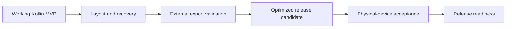
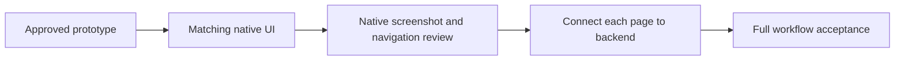

# Folio - project reference

Folio is a native Android scanner built in Kotlin and Jetpack Compose. Supports document correction, on-device OCR, searchable scan PDFs, regenerated text PDFs, front/back card pairing, and multiple-card page layouts.

Current phase: native UI alignment with the approved browser wireframe/prototype. Backend expansion and release work are deferred until this visual and navigation pass is reviewed. Existing Kotlin engines remain intact.

## Documentation rules

- `/docs` contains exactly the six Markdown files listed below, and nothing else.
- All project documentation changes must update these six existing files.
- Do not create additional Markdown files anywhere in this project, including README, AGENTS, changelog, task notes, or generated Markdown exports.
- Put new topics under the appropriate existing file. Add sections instead of files.
- Generated PDFs remain outside `/docs`; they are reference snapshots, not editable documentation sources.
- Scripts must not generate Markdown files or add files to `/docs`.

## Six-file map

| File | Owns |
| --- | --- |
| [Project.md](Project.md) | Scope, project status, documentation rules, file map |
| [Architecture.md](Architecture.md) | System architecture, data flow, screen map, technical decisions |
| [Frontend.md](Frontend.md) | Frontend design prompt, screen behavior, prototype handoff |
| [Fundamentals.md](Fundamentals.md) | Computer vision concepts and learning exercises |
| [Backend.md](Backend.md) | Kotlin implementation sequence and technical validation gates |
| [Testing.md](Testing.md) | Quality checks, acceptance criteria, validation evidence |

## Source ownership

Use Architecture for system decisions and Frontend for detailed screen design. Fundamentals explains concepts; Backend tracks engineering work; Testing owns verification. Update affected existing files together when decisions change.

## Existing artifact

[Architecture PDF](../output/pdf/Architecture.pdf): 11-page design-baseline snapshot from 14 October 2026. Markdown is the current source; regenerate the PDF after substantive architecture changes when requested.

## Current design handoff

- [Wireframe and interactive prototype](../design/index.html)
- [Frontend design specification](Frontend.md)
- [Prototype verification](Testing.md)

The prototype contains 15 functional screens plus logo boot and two first-run onboarding states. It is a browser review artifact. Native capture, correction, persistence, OCR and both PDF exports work under `android/`; build and device evidence are tracked in Testing.md. Full native visual parity and release validation remain unfinished.

## Permanent design website

The user explicitly requested retaining the website on 14 October 2026. Keep `design/`, its prototype, assets, concepts, and reference screens in this project alongside the future Android app. Do not remove or replace the website when Kotlin implementation starts.

Double-click `Start Scanner Design.command` to start/open the website. Alternatively run `python3 tools/serve_design.py --open` from the project root. Default URL: `http://127.0.0.1:8770`. The launcher reuses an existing matching preview. Closing the server does not remove any website files or assets; use the launcher to reopen it.

## Public repository

Product/repository name: **Folio**. GitHub: https://github.com/InsaneCoder789/Folio. The local workspace remains `OCR Scanner`; no project files were moved. Initial Android application ID remains `com.rohanc.ocrscanner` to preserve install identity. Historical screen artwork and architecture PDF retain their original working title. Credentials, local SDK paths, build outputs, signing keys, logs and local integration metadata stay out of Git.

## Native workflow expansion

The native MVP implements all 15 functional routes plus first-run entry, CameraX capture, manual/automatic boundaries, OpenCV correction and enhancement, text review, manual card pairing, PDF placement, actual searchable/text PDF export, preview, save/share, local search/settings and an optional processing lab. WorkManager handles resumable OCR batches. The latest recorded native gate passed 23 JVM and 27 API-34 checks. The permanent website remains alongside the Android app.

The current backend gate passed build/lint, 23 JVM checks and 27 API-34 device checks. The working debug APK and verification evidence are listed in [Backend.md](Backend.md) and [Testing.md](Testing.md). Physical-phone and release validation are next.

## Active completion goal

Finish the remaining native app work and show Folio in a visible emulator. Preserve the design website. Push verified changes directly to `main`; create PRs only when requested.

| Gate | Required evidence | Current state |
| --- | --- | --- |
| Visible app | Booted, installed, foreground app in a visible emulator | Passed on Folio_API34; onboarding displayed |
| Native UI finish | All routes, small/large text, landscape, navigation, accessible crop controls | In progress |
| Recovery | Recreation/process recovery, cancellation, large batches and storage failure checks | Partial; core revisions and atomic imports passed |
| External export | Save through Android Files; share/open grants consumed by a second app | Implemented; integration checks pending |
| Release candidate | Shrunk build, measured per-device package, signing configuration and runtime check | Pending |
| Physical quality | Consented photos, lighting/blur/card cases, measured OCR errors and timings | Needs physical phone and representative samples |
| Release packaging | Final privacy disclosures, signed release, support/API coverage and distribution | Pending; no store publication requested |

Scope extensions remain explicit: non-Latin/handwriting OCR, complex page reconstruction, automatic card-type identification/pairing and known-size card printing are not implemented. They are later features; they must not be silently counted as finished.

## UI-first correction - 14 October 2026

The user rejected the initial generic native form layout. The approved permanent prototype is the visual authority: `design/prototype/`, its 15 screen frames and two onboarding states. Translate that design into Compose before expanding backend behavior.

Keep the existing backend and unfinished release/recovery work. Do not resume those gates as a substitute for fixing the UI. The earlier broad goal remains paused; this requested UI correction is the current work. Push completed, verified changes directly to main.

## Visible tester policy - 15 October 2026

Use only the user's already-running **Pixel_9_Pro** emulator (`emulator-5554`, currently API 37) for this UI work. Keep tests visible so the user can watch. Do not start another emulator, run a headless emulator, change its display configuration, wipe its data, or stop the user's Pixel instance.

Run `python3 tools/verify_android_visible.py --serial emulator-5554`. This installs with replacement, runs instrumentation directly, records actual results and leaves the same emulator open in native UI review. The old isolated-AVD runner is retained as historical tooling; it is not the authorized workflow for this work.

Current UI delivery: all 15 native routes plus two onboarding steps implemented against the approved prototype; 34 device tests and 23 JVM tests passed on the existing Pixel 9 Pro. See Frontend.md and Testing.md. User acceptance of this native pass precedes the next page-by-page backend increment.
